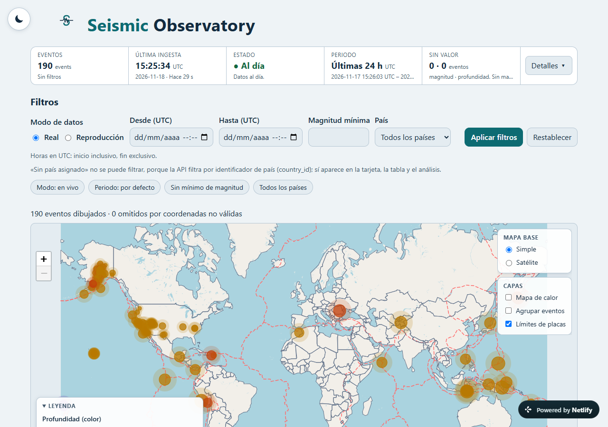
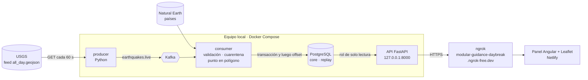
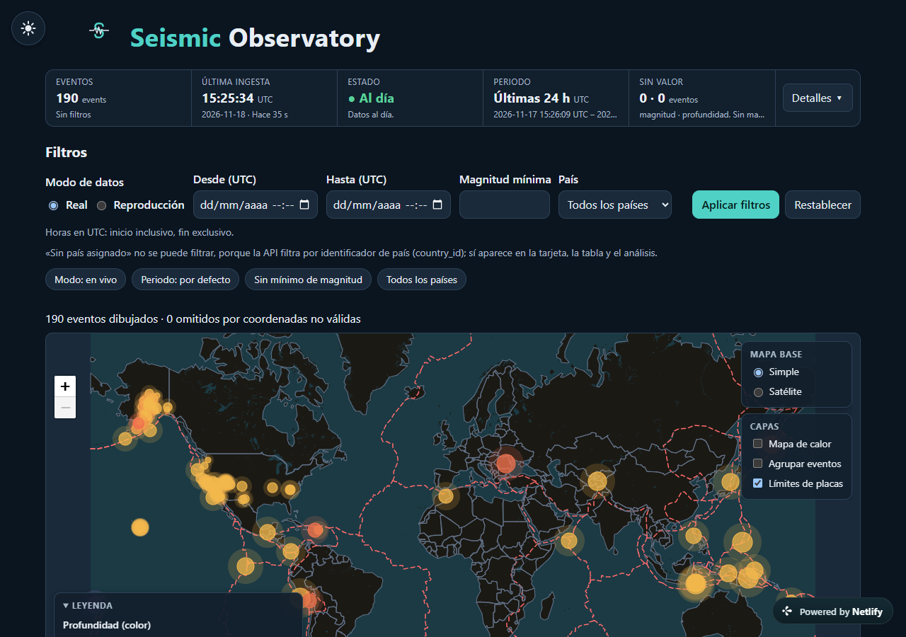
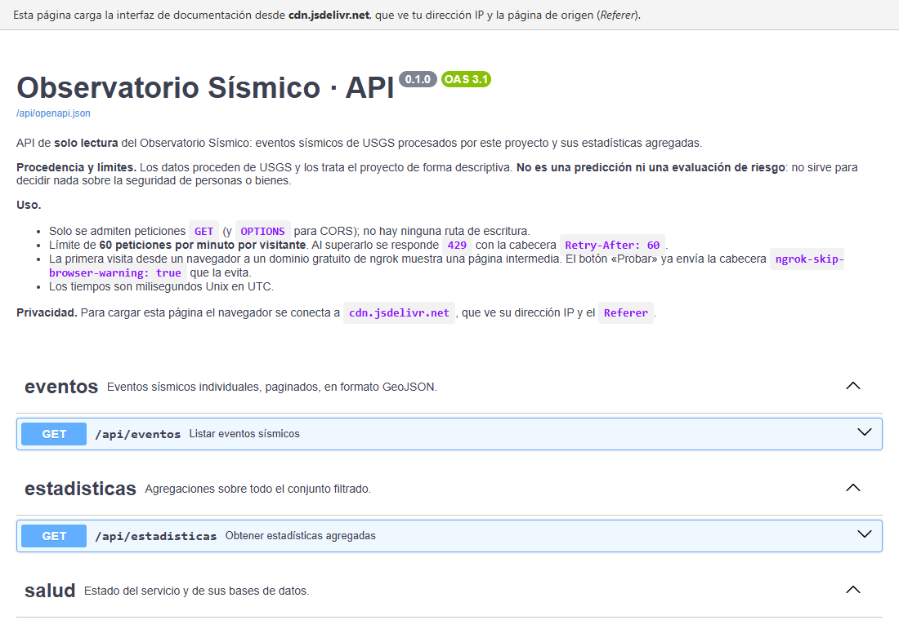

<div align="center">

# 🌍 Observatorio Sísmico

**Pipeline de streaming ETL con datos reales de terremotos: USGS → Kafka → PostgreSQL → API → panel con mapa.**

[](https://seismicobservatoryecr.netlify.app/)
[](https://modular-guidance-daybreak.ngrok-free.dev/docs)


<a href="https://seismicobservatoryecr.netlify.app/"></a>

</div>

## 🔗 Enlaces

| Qué | Dónde | Notas |
|---|---|---|
| 🗺️ **Panel** (mapa, gráficos y tabla) | <https://seismicobservatoryecr.netlify.app/> | Alojado en **Netlify**; siempre carga |
| 📖 **Documentación interactiva de la API** (Swagger UI, con «Probar») | <https://modular-guidance-daybreak.ngrok-free.dev/docs> | Pasa por **ngrok**; la raíz del dominio redirige aquí |
| 💓 Estado del servicio | <https://modular-guidance-daybreak.ngrok-free.dev/api/salud> | `ok` o `degraded` |
| 📄 Contrato OpenAPI | <https://modular-guidance-daybreak.ngrok-free.dev/api/openapi.json> | Solo lectura: `GET` |

> [!IMPORTANT]
> **El backend corre en un equipo local** (Docker Compose) y se publica con un túnel de ngrok. Si el equipo o el túnel
> están apagados, el panel de Netlify sigue cargando pero muestra un aviso de «backend inaccesible» con la última lectura, y los
> enlaces de ngrok no responden. Es el comportamiento previsto por el enunciado, no un fallo.
>
> La primera visita a un dominio gratuito de ngrok desde un navegador muestra una página intermedia: pulsa **«Visit Site»**.
> Hay un límite de **60 peticiones por minuto por visitante** (respuesta 429).

## 🧭 Cómo funciona



| Paso | Qué ocurre |
|---|---|
| 1 | El **productor** consulta USGS cada 60 s y publica en Kafka solo las versiones nuevas de cada evento. |
| 2 | El **consumidor** valida, aparta lo inválido en cuarentena (con el motivo) y asigna el país con punto en polígono. |
| 3 | **PostgreSQL** guarda el estado actual, el historial de versiones y la cuarentena; una versión antigua nunca pisa a una más reciente. |
| 4 | La **API** (solo lectura) sirve eventos, estadísticas y estado; el **túnel ngrok** la expone por HTTPS. |
| 5 | El **panel** de Netlify consulta la API cada 60 s y muestra mapa, filtros, gráficos y tabla. |

## 🚀 Arranque rápido

Requisitos: Docker con Compose v2 y Git (detalle en el [apartado 3](#3-requisitos-y-versiones)).

```bash
git clone https://github.com/escastel/seismic_observatory.git && cd seismic_observatory
cp .env.example .env          # sustituye cada CHANGE_ME_LOCALLY por una contraseña local
docker compose up --build -d  # productor, consumidor, Kafka, PostgreSQL y API
curl -s http://127.0.0.1:8000/api/salud
```

| Quiero… | Hago… |
|---|---|
| Ver la documentación de la API en local | Abrir <http://127.0.0.1:8000/docs> |
| Publicar la API con ngrok | `docker compose --profile tunnel up -d` ([apartado 5](#5-túnel-para-el-panel-publicado)) |
| Cargar el histórico de 2025 | [Cargar el histórico](#cargar-el-histórico) |
| Demostrar la reproducción acelerada | [Reproducción acelerada](#reproducción-acelerada) |
| Preparar la defensa | [Procedimiento de la defensa](#10-panel-angular-y-defensa-spec-007) |

## 🖼️ Capturas

| Panel · claro | Panel · oscuro |
|---|---|
|  |  |

| Documentación interactiva de la API (`/docs`) |
|---|
|  |

## 🗂️ Dónde está cada cosa

| Entregable | Ubicación |
|---|---|
| Memoria: decisiones, calidad, modelo, análisis, costes | [docs/report.md](docs/report.md) |
| Calidad de los datos | [docs/calidad.md](docs/calidad.md) |
| Evaluación financiera | [docs/evaluacion-financiera.md](docs/evaluacion-financiera.md) |
| Evidencias de las pruebas (esperado y observado) | [docs/evidence/](docs/evidence/) |
| SQL de creación, índices y consultas | [db/sql/](db/sql/) y [db/queries/](db/queries/) |
| Código | [producer/](producer/) · [consumer/](consumer/) · [api/](api/) · [frontend/](frontend/) · [common/](common/) |
| Política de tráfico del túnel (60 por minuto) | [tunnel/traffic-policy.yml](tunnel/traffic-policy.yml) |
| Especificaciones de cada funcionalidad | [specs/](specs/) |

---

Sistema local y reproducible de streaming ETL que ingiere, valida, enriquece y sirve los
terremotos del feed GeoJSON de USGS: productor → Kafka → consumidor → PostgreSQL → API FastAPI,
consultada por un panel Angular/Leaflet publicado en Netlify a través de un túnel ngrok.

## 1. Objetivo académico

El sistema demuestra un pipeline de datos con semántica **al menos una vez**, idempotente y
versionado, con calidad auditable e integración espacial:

- Los eventos originales se publican en Kafka antes de procesarse.
- El consumidor nunca descarta en silencio un evento inválido: lo guarda en cuarentena con el
  mensaje original y todos los motivos.
- Los eventos válidos se cruzan con los polígonos de Natural Earth (punto en polígono).
- La transacción de PostgreSQL se confirma antes que el offset de Kafka.
- Una versión antigua de un evento nunca sustituye a una más reciente, y cada versión queda en
  el historial.
- La reproducción acelerada del histórico escribe en un esquema propio, separado de los datos
  reales.

## 2. Arquitectura

`docker compose up --build -d` levanta exactamente cinco servicios:

| Servicio | Responsabilidad | Tecnología |
|---|---|---|
| `producer` | Consulta USGS cada 60 s y publica las versiones nuevas | Python, `requests`, `aiokafka`, `asyncpg` |
| `consumer` | Validación, cuarentena, cruce espacial y persistencia | Python, GeoPandas, Shapely, `aiokafka`, `asyncpg` |
| `api` | Consultas filtrables, estadísticas y GeoJSON | FastAPI, Pydantic, `asyncpg` |
| `kafka` | Topics `earthquakes.live`, `earthquakes.catalog` y `earthquakes.replay` | Kafka 3.7 en modo KRaft |
| `postgres` | Modelo de datos (esquemas `core` y `replay`) | PostgreSQL 16 |

El túnel ngrok es un sexto servicio opcional, `tunnel`, que solo arranca con
`--profile tunnel` (apartado 5). El panel Angular no es un contenedor: se publica en Netlify
desde `frontend/`. Desde la spec 009 tiene tema claro u oscuro según el dispositivo, mapa con fondos Simple y Satélite (desde la spec 010 se retiró Relieve) y capas opcionales (calor, agrupación y límites de placas), barra de estado, avisos por gravedad, botón de tema, gráficos con tabla y ficha de evento; detalle y licencias en [docs/report.md](docs/report.md#panel-rediseñado-spec-009) y [ajustes de la spec 010](docs/report.md#ajustes-del-panel-spec-010).

El modelo de datos, sus decisiones y el diccionario están en
[specs/002-platform-data-model/data-model.md](specs/002-platform-data-model/data-model.md) y en
[docs/report.md](docs/report.md); la interfaz que usan los servicios, en
[contracts/database.md](specs/002-platform-data-model/contracts/database.md).

### Red y superficie expuesta

Solo la API publica un puerto, y únicamente en el propio equipo (`127.0.0.1:8000`). Kafka tiene
un único listener interno (`kafka:9092`) y PostgreSQL no publica ninguno: nada fuera de la red de
Compose puede escribir en el broker ni en la base. Es una decisión deliberada: la API es la única
pieza que llega a Internet, a través del túnel, y se conecta con un rol de solo lectura
(`observatory_reader`). Las herramientas que necesitan Kafka o PostgreSQL se ejecutan dentro de
la red con `docker compose exec` o con el servicio de pruebas de `compose.dev.yaml`.

### Entrega y versiones

El consumidor desactiva la confirmación automática de offsets. Por cada mensaje abre una
transacción, aplica la versión con `apply_event_version` (o la guarda en cuarentena), anota el
mensaje en `message_log`, confirma la transacción y solo entonces confirma el offset. Si algo
falla, reintenta el mismo mensaje con espera creciente y no confirma ningún offset posterior. Un
grupo de consumo nuevo empieza por el principio del topic.

La función `apply_event_version` devuelve `new`, `revised`, `stale` o `duplicate`: el estado
actual solo cambia con un `updated` posterior al guardado, y reprocesar un mensaje no cambia
nada.

### Eventos sin país

Si el punto no cae dentro de ningún polígono del catálogo, el evento se guarda con país nulo y
el panel muestra «Sin país asignado»; nunca se imputa el país más cercano.

## 3. Requisitos y versiones

- Docker Engine 26 o posterior con Docker Compose v2 (en Windows y macOS, Docker Desktop).
- Unos 3 GB libres para las imágenes y 8 GB de RAM.
- Git. En Windows, las órdenes de este documento se escriben para Git Bash.

Imágenes fijadas: `postgres:16.4`, `confluentinc/cp-kafka:7.7.1`,
`python:3.11.10-slim-bookworm` (base de productor, consumidor y API) y
`ngrok/ngrok:3.39.13-alpine` (túnel). Las dependencias de Python están fijadas con todas sus
transitivas en el `requirements.txt` de cada servicio.

## 4. Puesta en marcha

### Crear `.env`

```bash
cp .env.example .env
```

Editar `.env` y sustituir cada `CHANGE_ME_LOCALLY` por una contraseña local: `POSTGRES_PASSWORD`
(propietario de la base), `DB_WRITER_PASSWORD` (productor y consumidor) y `DB_READER_PASSWORD`
(API). Poner en `CORS_ORIGINS` el origen exacto del sitio de Netlify. `.env` está en
`.gitignore`: no se versiona nunca. La lista completa de variables está en
[contracts/runtime.md](specs/002-platform-data-model/contracts/runtime.md) y, para la ingesta,
en [contracts/runtime.md de la spec 003](specs/003-usgs-ingestion/contracts/runtime.md).

### Arrancar

```bash
docker compose up --build -d
```

La primera vez la base se crea sola desde `db/sql/` (esquemas, roles, dimensiones con los 177
países y los días de 1900 a 2035, tablas de eventos y privilegios). No hay pasos manuales.

### Comprobar el estado y los logs

```bash
docker compose ps
curl -s http://127.0.0.1:8000/api/salud
docker compose logs -f producer consumer
```

Los cinco servicios deben aparecer como `healthy` en menos de tres minutos con las imágenes ya
construidas. La salud del productor y del consumidor se basa en un latido; la de la API, en
`GET /api/salud`, que responde `degraded` si la base no está disponible. El productor actualiza
el latido tras cada consulta a USGS que queda registrada, **también si USGS falla**: un fallo de
la fuente no es un fallo del servicio y se ve en la antigüedad de la última ingesta. El productor
deja de estar sano si no puede registrar las consultas (base caída) o Kafka rechaza los
mensajes durante más de tres intervalos. Si una dependencia cae, los servicios reintentan con
espera exponencial de 1 s a 30 s y se recuperan sin reiniciarlos.

Cada consulta al feed queda en `core.extraction`. Para ver la última ingesta correcta, abrir
`psql` como se indica a continuación y ejecutar:

```sql
SELECT max(requested_at) FROM core.extraction
WHERE source = 'usgs_feed' AND outcome IN ('ok', 'not_modified');
```

Para consultar la base:

```bash
docker compose exec postgres sh -c 'psql -U "$POSTGRES_USER" -d "$POSTGRES_DB"'
```

### Parar

```bash
docker compose down
```

Se conservan los volúmenes `postgres_data` (eventos, versiones, cuarentena y estado de
publicación) y `kafka_data` (mensajes durante 7 días y offsets confirmados). Al volver a
arrancar, el productor no republica versiones ya publicadas y el consumidor sigue donde lo dejó.

### Recrear la base desde cero

Los ficheros de inicialización solo se ejecutan con el volumen vacío. Para aplicar un cambio
del modelo, o si el volumen viene de una versión anterior, hay que borrar los volúmenes.
**Esto elimina todos los datos locales**:

```bash
docker compose down -v
docker compose up -d
```

## 5. Túnel para el panel publicado

> **Este proyecto:** dominio de ngrok `modular-guidance-daybreak.ngrok-free.dev` (`NGROK_DOMAIN`) y panel en Netlify
> `seismicobservatoryecr.netlify.app`, que debe figurar en `CORS_ORIGINS`. El panel lee la URL de la API de `frontend/public/config.json`.

Con `NGROK_AUTHTOKEN` y `NGROK_DOMAIN` (dominio reservado) en `.env`:

```bash
docker compose --profile tunnel up -d
docker compose --profile tunnel logs tunnel
curl -s "https://TU-DOMINIO.ngrok-free.app/api/salud" -H "ngrok-skip-browser-warning: 1"
```

El túnel apunta a `http://api:8000` dentro de la red de Compose. Para retirarlo:

```bash
docker compose --profile tunnel stop tunnel
```

Sin `--profile tunnel` el servicio no arranca, y los cinco obligatorios funcionan igual.

### Documentación interactiva de la API (spec 011)

La API sirve una documentación interactiva (Swagger UI) en `/docs`, con «Probar» para los tres
endpoints de datos, y la raíz `/` redirige a ella:

- En local: <http://127.0.0.1:8000/docs>.
- Por el túnel: `https://TU-DOMINIO.ngrok-free.app/docs` (la primera vez, ngrok muestra su página
  intermedia: pulsa «Visit Site»; «Probar» ya envía `ngrok-skip-browser-warning`).

La página carga Swagger UI desde `cdn.jsdelivr.net` (versión exacta con integridad), que ve la
dirección IP y el `Referer` del navegador. `/redoc` sigue desactivada. El túnel aplica un límite de
**60 peticiones por minuto por visitante** (respuesta 429) definido en
[tunnel/traffic-policy.yml](tunnel/traffic-policy.yml) y montado en el servicio `tunnel`.

## 6. Consultar la API

La referencia completa e interactiva está en **`/docs`** (Swagger UI, con «Probar»): en local
<http://127.0.0.1:8000/docs> y por el túnel <https://modular-guidance-daybreak.ngrok-free.dev/docs>. El
contrato escrito está en [specs/006-query-api/contracts/api.md](specs/006-query-api/contracts/api.md).

Base: `http://127.0.0.1:8000/api` (o la URL del túnel del apartado 5, añadiendo la cabecera
`-H "ngrok-skip-browser-warning: 1"`). Solo acepta `GET` y `OPTIONS`; cualquier otro método
devuelve 405. Los tiempos son milisegundos Unix en UTC; las fechas de entrada van en ISO 8601 con
zona horaria (`2025-01-01T00:00:00Z`) y, sin zona, devuelven 422.

| Endpoint | Qué devuelve | Ejemplo |
|---|---|---|
| `GET /api/eventos` | Eventos como GeoJSON, paginados (`limit` hasta 1.000 y `offset`), con un bloque `metadata`. Sin parámetros: últimas 24 horas. `start` es inclusivo y `end` exclusivo. | `curl "http://127.0.0.1:8000/api/eventos?start=2025-01-01T00:00:00Z&end=2025-02-01T00:00:00Z&min_mag=4&country_id=ESP"` |
| `GET /api/estadisticas` | Agregaciones sobre todo el conjunto filtrado: por hora UTC, por país, distribuciones de magnitud y profundidad y comparación con 2025. | `curl "http://127.0.0.1:8000/api/estadisticas?min_mag=4"` |
| `GET /api/salud` | Estado del servicio y de las dos bases de datos (`ok` o `degraded`); responde siempre 200. | `curl "http://127.0.0.1:8000/api/salud"` |

Filtros comunes: `mode` (`live` o `replay`), `start`, `end`, `min_mag`, `country_id` y
`exclude_synthetic`. Para recorrer todas las páginas de `/api/eventos` se repite la petición con
`metadata.next_offset` como `offset` hasta que sea `null`.

**Modo reproducción.** Con `mode=replay` se consulta el esquema de reproducción en lugar de los datos
reales, sin la ventana de 24 horas por defecto; `metadata.label` es `"REPRODUCCIÓN"` y ninguna
respuesta mezcla los dos esquemas. `exclude_synthetic=true` quita los casos sintéticos.

```bash
curl "http://127.0.0.1:8000/api/eventos?mode=replay&exclude_synthetic=true&limit=5"
```

**Errores.** Siempre JSON, nunca `features: []` con 200 por un fallo:

| Código | Cuándo | Cuerpo |
|---|---|---|
| 422 | Parámetro inválido | `{"error": "invalid_parameters", "detail": [{"param": "...", "message": "..."}]}` |
| 503 | Base de datos no disponible; se recupera sola al volver la base | `{"error": "database_unavailable", "detail": "..."}` |
| 500 | Error inesperado | `{"error": "internal_error", "detail": "..."}` |
| 429 | Más de 60 peticiones por minuto por visitante (solo por el túnel) | `{"error": "too_many_requests", "message": "..."}` |

`metadata.last_ingestion` es la última consulta correcta a USGS y mide la frescura de los datos.

## 7. Datos

- `data/`: ubicación de los conjuntos descargados. Está fuera de Git; la carga del catálogo
  escribe en `data/usgs/catalog/` y el productor y el consumidor lo montan en solo lectura en
  `/data`. La base guarda la huella y la ruta de cada fichero (`core.raw_payload`).
- `db/seeds/`: lotes pequeños versionados para la reproducción, montados en `/seeds`. Ver
  [db/seeds/README.md](db/seeds/README.md).
- `frontend/public/datos/paises.geojson`: catálogo Natural Earth de 177 países, del que salen
  `core.dim_country` y el cruce espacial del consumidor.

Ninguna imagen contiene conjuntos de datos: se montan al ejecutar.

### Cargar el histórico

El histórico obligatorio (2025, mundial, magnitud ≥ 4, tipo terremoto) se carga a mano, una
vez, con el sistema arrancado:

```bash
docker compose run --rm catalog-loader
```

Tarda alrededor de un minuto con una conexión doméstica y deja unos 18.300 terremotos en el
esquema `core`. La orden divide el año en meses, pide primero a USGS cuántos eventos tiene cada
uno, divide el intervalo si supera el máximo de 20.000 y comprueba que cada descarga trae
exactamente lo declarado; nunca acepta una respuesta truncada. Al terminar muestra un resumen:

```text
Eventos distintos:      18302
Declarados por USGS:    18302   (recuento del periodo completo al terminar)
Diferencia:             0
```

| Código de salida | Significado |
|---|---|
| 0 | Carga completa, diferencia cero |
| 1 | Error (USGS no responde, Kafka o la base no están disponibles). Lo hecho se conserva: repetir la misma orden continúa |
| 2 | Argumentos no válidos; no se consulta USGS |
| 3 | Terminada, pero con diferencia frente al total de USGS; el resumen la detalla |

Repetir la orden no descarga de nuevo los meses ya completos ni publica nada dos veces. Para
actualizar la instantánea con las revisiones posteriores de USGS, añadir `--refresh`.

Otras opciones (ver [contracts/catalog-loader.md](specs/003-usgs-ingestion/contracts/catalog-loader.md)):

```bash
# Ampliación con 2026 hasta una fecha, con el mismo filtro
docker compose run --rm catalog-loader --start 2026-01-01 --end 2026-11-15

# Ver qué se descargaría, sin descargar ni publicar
docker compose run --rm catalog-loader --dry-run
```

Las respuestas se guardan sin modificar en `data/usgs/catalog/`, una por intervalo, con la huella
en el nombre (`2025-01-01T000000Z_2025-02-01T000000Z_m4_earthquake_<huella>.geojson`), y un
resumen `summary-*.json` por carga. Para comprobar que un fichero no ha cambiado:

```bash
(cd data && sha256sum usgs/catalog/*.geojson)
```

y comparar con `SELECT file_path, content_sha256 FROM core.raw_payload WHERE encoding = 'file'`.
Para regenerarlos desde cero basta con borrar `data/usgs/catalog/` y repetir la carga: un
intervalo cuyo fichero falta o no coincide con su huella se vuelve a descargar.

**En Linux**, la carga escribe en `./data` con el usuario indicado en `LOADER_UID` y
`LOADER_GID` (por defecto, `root`). Para que los ficheros sean tuyos:

```bash
LOADER_UID=$(id -u) LOADER_GID=$(id -g) docker compose run --rm catalog-loader
```

o escribir esos dos valores en `.env`. En Windows y macOS con Docker Desktop no hace falta.

### Paradas de más de 24 horas

El feed solo cubre las últimas 24 horas. Si el sistema ha estado parado más tiempo, al arrancar
el productor escribe en su log un aviso con el periodo perdido y la orden exacta para
recuperarlo, y sigue con el feed:

```bash
docker compose logs producer | grep "Ingestion gap detected"
docker compose run --rm catalog-loader --gaps      # huecos pendientes y recuperados
docker compose run --rm catalog-loader --purpose gap_recovery --start <inicio> --end <fin>
```

La recuperación trae todas las magnitudes del periodo, como el feed, y no duplica nada.

### Originales del feed

Cada respuesta distinta del feed se guarda comprimida en `core.raw_payload` y se borra cuando
lleva más de `RAW_PAYLOAD_RETENTION_DAYS` días (7) sin observarse. El productor purga al
arrancar y cada 24 horas; las consultas registradas no se borran nunca.

### Reproducción acelerada

```bash
docker compose run --rm replay start --start 2025-01-01 --end 2025-04-01 --min-mag 4.0 --rate 200
```

Los mensajes van a `earthquakes.replay` y el consumidor los escribe en el esquema `replay`, que
no puede modificar los datos reales de `core`. La selección sale de lo ya descargado en
`data/usgs/catalog/`; no se consulta a USGS. El procedimiento completo de la demostración de la
defensa (pausar, reanudar, detener, repetir y comprobar el aislamiento) está en
[Demostración de la defensa](#demostración-de-la-defensa).

### Demostración de la defensa

Sirve para enseñar el sistema con actividad aunque no ocurra ningún terremoto durante la defensa: se
reproduce a velocidad acelerada una selección del histórico ya descargado, por el mismo camino que los
datos reales (Kafka → consumidor → PostgreSQL), pero en el esquema `replay`, sin tocar `core`. No
consulta a USGS. Los datos reproducidos se reconocen desde la base por estar en el esquema `replay` y
tener `replayed_at`; el etiquetado «REPRODUCCIÓN» en la API y el panel llega con las specs 006 y 007.

**Requisitos**: el stack levantado y sano (`docker compose up --build -d`) y el catálogo de 2025 con
magnitud ≥ 4 descargado y registrado (`docker compose run --rm catalog-loader`, apartado
[Cargar el histórico](#cargar-el-histórico)). En Linux, antes de empezar:
`export LOADER_UID=$(id -u) LOADER_GID=$(id -g)` (la orden escribe sus ficheros de control en
`./data/replay/`). Todas las órdenes se lanzan desde la raíz del repositorio y no necesitan
`MSYS_NO_PATHCONV` en Git Bash.

En el texto, «terminal 1» y «terminal 2» son dos terminales abiertas en la raíz del repositorio.

**1. Ver la selección sin publicar** (terminal 1). Con enero a abril de 2025 y magnitud ≥ 4 salen
5.301 eventos:

```bash
docker compose run --rm replay select --start 2025-01-01 --end 2025-05-01 --min-mag 4.0
```

Anota el `extraction_id`: la selección queda registrada en `core.extraction` con propósito
`replay_selection`. Se rechaza, con código de salida 2, un periodo no descargado, una magnitud mínima
inferior a la del catálogo o un fichero alterado. Para limitar a una zona, `--bbox=` con
`min_lon,min_lat,max_lon,max_lat` (con el signo menos pegado: `--bbox=-125,32,-114,42`).

**2. Preparar la comprobación de aislamiento** (opcional, recomendada). El feed real escribe en `core`
por su cuenta, así que se para el productor mientras dura la comprobación y se toma una instantánea
(recuento y suma de comprobación de cada tabla de `core`):

```bash
docker compose stop producer
docker compose run --rm replay reset
docker compose run --rm replay snapshot
```

**3. Reproducir** (terminal 1). `--rate` son eventos por segundo; `--speedup 3600` añadiría un factor
sobre el tiempo original (con ambos, la cadencia nunca supera `--rate`). A 200 eventos/s, 5.301
eventos tardan unos 27 s; a 20 se alarga lo bastante para enseñar el control:

```bash
docker compose run --rm replay start --start 2025-01-01 --end 2025-05-01 --min-mag 4.0 --rate 20
```

**4. Controlarla** (terminal 2, mientras corre la 1). Solo puede haber una reproducción activa:

```bash
docker compose run --rm replay status    # estado, enviados, restantes
docker compose run --rm replay pause     # deja de publicar; el contador no avanza
docker compose run --rm replay resume    # sigue por el siguiente evento, sin saltos
docker compose run --rm replay stop      # termina; lo ya publicado se conserva
```

**5. Enseñar lo reproducido en la base** (cuando el consumidor esté al día):

```bash
docker compose exec -T postgres sh -c 'psql -U "$POSTGRES_USER" -d "$POSTGRES_DB" -c "SELECT count(*), min(replayed_at), max(replayed_at) FROM replay.event_current"'
docker compose exec -T postgres sh -c 'psql -U "$POSTGRES_USER" -d "$POSTGRES_DB"' < docs/evidence/005/sql/v2-replayed-data.sql
```

La segunda consulta muestra que todo lo reproducido está en `replay`, que cada evento conserva su
tiempo de ocurrencia original (`event_time` sigue siendo de 2025; solo `replayed_at` es de hoy) y que
`core` no recibió nada del topic de reproducción.

**6. Comprobar que `core` no cambió** (con el productor parado, paso 2):

```bash
docker compose run --rm replay compare   # "core idéntico a la instantánea", código de salida 0
```

**7. Repetir desde cero**: `reset` vacía solo las tablas de `replay` (no existe operación equivalente
en `core`), y se vuelve a lanzar el paso 3. El resultado es idéntico al de la primera vez.

```bash
docker compose run --rm replay reset
```

**8. Casos sintéticos** (primera versión, repetición exacta, revisión, versión antigua tardía y un
mensaje a cuarentena; 7 mensajes con resultado conocido):

```bash
docker compose run --rm replay reset
docker compose run --rm replay start --synthetic-only
docker compose exec -T postgres sh -c 'psql -U "$POSTGRES_USER" -d "$POSTGRES_DB"' < docs/evidence/005/sql/v6-synthetic-cases.sql
```

Esperado: `new` 3, `duplicate` 1, `revised` 1, `stale` 1 y `quarantined` 1. Con `--synthetic` en lugar de
`--synthetic-only`, los siete mensajes se añaden al final de una selección real.

**9. Al terminar**: `docker compose start producer` para reanudar la ingesta real.

Notas:

- El consumidor puede reiniciarse a mitad de la reproducción (`docker compose restart consumer`): al
  terminar, el resultado es el mismo que sin reinicio.
- Si se crea un consumidor con un grupo nuevo, empieza por el principio del topic de reproducción
  (retención de 168 h) y repuebla `replay` con reproducciones anteriores; no afecta a `core`.
- Procedimiento detallado y evidencia de cada escenario en
  [specs/005-historical-replay/quickstart.md](specs/005-historical-replay/quickstart.md) y
  [docs/evidence/005/](docs/evidence/005/README.md); explicación y resultados medidos en
  [docs/report.md](docs/report.md#reproducción-histórica).

## 8. Pruebas

Las pruebas se ejecutan en un contenedor dentro de la red de Compose, contra una base temporal
`observatory_test` que se crea con los mismos ficheros de `db/sql/` y se elimina al terminar:

```bash
docker compose -f compose.yaml -f compose.dev.yaml run --rm tests pytest tests/db -v
docker compose -f compose.yaml -f compose.dev.yaml run --rm tests pytest tests/unit tests/contract -v
docker compose -f compose.yaml -f compose.dev.yaml run --rm tests pytest tests/unit/test_replay_*.py -v
```

`tests/db` cubre la secuencia de duplicados y revisiones de la FAQ 12, nulos y rangos,
idempotencia con 1.000 pasadas, privilegios, aislamiento de la reproducción y procedencia. Los
escenarios de validación con el sistema real están en
[specs/002-platform-data-model/quickstart.md](specs/002-platform-data-model/quickstart.md), y
sus resultados en [docs/evidence/002/](docs/evidence/002/).

## 9. Límites tecnológicos

El proyecto usa únicamente el stack aprobado: Python, Kafka, PostgreSQL, FastAPI, Docker
Compose, Angular y Leaflet. No usa PostGIS, Spark, Flink ni Kubernetes: el cruce espacial se
hace en Python con GeoPandas.

## 10. Panel Angular y defensa (spec 007)

El panel (`frontend/`) lee solo la API de la spec 006 y se publica en Netlify; el backend se queda en
este equipo y se expone con un túnel. Su configuración está en `frontend/public/config.json`. El modo
demo se ha retirado: el panel muestra solo datos de la API, en modo real o de reproducción, y la
reproducción lleva la etiqueta «REPRODUCCIÓN» en todas las vistas.

### Procedimiento

1. **Levantar el stack.**

   ```bash
   docker compose up --build -d
   curl -s http://127.0.0.1:8000/api/salud
   ```

2. **Levantar el túnel.** Con `NGROK_AUTHTOKEN` y `NGROK_DOMAIN` en `.env`, el servicio opcional de
   Compose sirve (ver [sección 5](#5-túnel-para-el-panel-publicado)):

   ```bash
   docker compose --profile tunnel up -d
   ```

   Alternativa: ngrok como agente en este equipo, apuntando a la API:

   ```bash
   ngrok http 8000 --domain=TU-DOMINIO.ngrok-free.app
   ```

   El authtoken **nunca** va en Git ni en el frontend: en el agente se guarda en la configuración
   local de ngrok, fuera del repositorio. Comprobar el túnel desde fuera:

   ```bash
   curl -s "https://TU-DOMINIO.ngrok-free.app/api/salud" -H "ngrok-skip-browser-warning: 1"
   ```

3. **Fijar la URL en `frontend/public/config.json` antes de compilar.** Copiar la URL HTTPS del túnel
   en `apiUrl`, sin `/api` al final (el panel añade las rutas). Campos:

   | Campo | Valor de ejemplo | Uso |
   |---|---|---|
   | `mode` | `live` o `replay` | Modo inicial; se puede cambiar en el panel |
   | `apiUrl` | `https://TU-DOMINIO.ngrok-free.app` | Base de la API, sin `/api` |
   | `refreshMs` | `60000` | Intervalo de refresco; el mínimo admitido es 5000 ms |
   | `requestTimeoutMs` | `15000` | Tiempo máximo de cada petición |
   | `staleAfterMs` | `900000` | A partir de esta antigüedad la lectura se marca como desactualizada |
   | `skipNgrokWarning` | `true` | Envía `ngrok-skip-browser-warning` para saltar la página intermedia de ngrok |

4. **Autorizar el origen de Netlify en CORS.** En `.env`, `CORS_ORIGINS` debe contener el origen
   exacto del sitio (esquema y host, sin barra final) más el de desarrollo, sin comodines:

   ```
   CORS_ORIGINS=https://TU-SITIO.netlify.app,http://localhost:4200
   ```

   Después, recrear la API para que lea el cambio: `docker compose up -d api`. `docker compose restart`
   no vuelve a leer `.env`.

5. **Instalar, probar y arrancar en local.** Node 22.12 o 24 (ver `engines` en `package.json`):

   ```bash
   cd frontend
   npm ci
   npm test
   npm start
   ```

   `npm ci` instala las versiones fijadas en `package-lock.json`. El panel queda en
   `http://localhost:4200`.

6. **Compilar y publicar en Netlify.** `netlify.toml` ya define la base `frontend`, el comando
   `npm run build` y la publicación de `dist/observatorio/browser`. Netlify compila desde el
   repositorio, así que la URL de `config.json` debe estar en la rama que se despliega (la URL no es
   secreta; el authtoken sí, y no debe estar nunca). El despliegue lo hace la persona autora.

7. **Comprobar desde otro dispositivo.** Abrir la URL de Netlify en un móvil con datos, fuera de la
   red del equipo. Debe cargar el mapa y la tabla, y mostrar el estado de frescura con la hora de la
   última ingesta.

8. **Si cambia la URL del túnel.** La URL queda compilada en el panel: no basta con reiniciar. Actualizar
   `apiUrl` en `config.json`, repetir `npm run build` y publicar de nuevo en Netlify. Si cambia el
   origen de Netlify, actualizar `CORS_ORIGINS` y recrear la API (paso 4).

Estado de las comprobaciones y lo que queda pendiente (túnel ngrok real y Netlify real):
[docs/evidence/007/README.md](docs/evidence/007/README.md).
