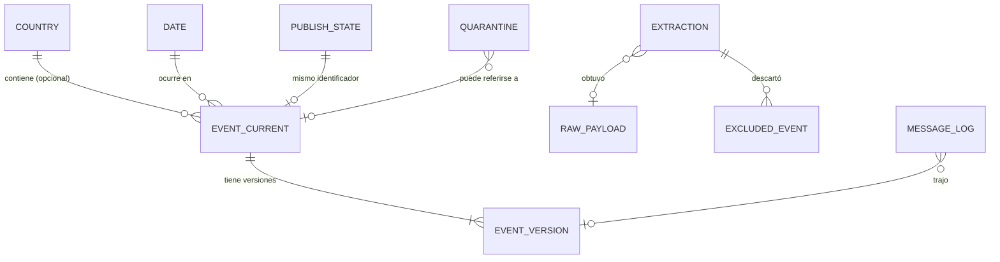

# Memoria del Observatorio Sísmico

Este documento reúne las decisiones de diseño del observatorio, su justificación y las evidencias de cada
funcionalidad (specs 002 a 009). Las cifras proceden de mediciones y consultas guardadas en `docs/evidence/NNN/`; cada apartado
indica el instante en que se obtuvieron, porque la base crece con el feed en vivo (por ejemplo, `core` tenía 34.045 eventos el
2026-11-16, 34.207 el 2026-11-17 y 32.978 terremotos reales en la medición de calidad del 2026-11-16: no son contradicciones, son
instantes distintos). Los datos sintéticos y de reproducción quedan fuera de todo análisis de datos reales.

**Índice**

1. [Alcance y decisiones](#alcance-y-decisiones)
2. [Fuentes y extracción](#fuentes-y-extracción)
3. [Calidad de los datos](#calidad-de-los-datos) (más detalle en [calidad.md](calidad.md))
4. [Reproducción histórica](#reproducción-histórica)
5. [API de consulta](#api-de-consulta)
6. [Panel Angular (spec 007)](#panel-angular-spec-007)
7. [Panel rediseñado (spec 009)](#panel-rediseñado-spec-009)
8. [Análisis y conclusiones (spec 008)](#análisis-y-conclusiones-spec-008)
9. [Complejidad y rendimiento (spec 008)](#complejidad-y-rendimiento-spec-008)
10. [Costes, escalado y mejoras (spec 008)](#costes-escalado-y-mejoras-spec-008) (y [evaluacion-financiera.md](evaluacion-financiera.md))
11. [Trazabilidad y cierre de entregables (spec 008)](#trazabilidad-y-cierre-de-entregables-spec-008)
12. [Modelo conceptual](#modelo-conceptual), [lógico](#modelo-lógico) y [físico](#modelo-físico)
13. [Diccionario de datos](#diccionario-de-datos)
14. [Índices](#índices)

## Alcance y decisiones

**Datos que el sistema debe guardar.** El enunciado exige el histórico mundial de 2025 con
magnitud ≥ 4 y tipo terremoto (unos 16.000 según el enunciado; el catálogo real cargado tiene 18.302) y el feed en vivo de USGS de las últimas
24 horas, consultado cada minuto (unos 200 eventos nuevos y hasta 10.080 consultas por semana).
El histórico de 2025 es dato real: se guarda en el esquema `core`, distinguido del feed por su
procedencia (`source = 'usgs_catalog'`), y no en el de reproducción. El modelo no impide cargar
el catálogo completo desde 1900: la dimensión de fecha empieza ese año y las tablas no tienen
límites de volumen; la carga ampliada queda para una funcionalidad posterior.

**Decisiones propias del modelo.**

| Decisión | Alternativa descartada | Razón |
|---|---|---|
| Esquemas `core` (real) y `replay` (reproducción) con la misma plantilla de tablas | Una columna «origen» en tablas compartidas | El aislamiento queda garantizado por la estructura: una consulta o un borrado de `replay` no puede tocar `core` |
| Regla de versiones en la función `apply_event_version` | Dos sentencias desde Python | La regla vive junto a sus restricciones, se prueba con SQL y devuelve el resultado que se cuenta (`new`, `revised`, `stale`, `duplicate`) |
| País nulo cuando el punto no cae en ningún polígono | Fila ficticia «Sin país asignado» | No se inventa una entidad en la dimensión; el texto lo pone la presentación |
| Magnitud y profundidad anulables, sin mínimo | Rechazar nulos y negativos | El principio III obliga a conservar o señalar; una magnitud negativa o una profundidad sobre el nivel del mar son reales |
| Tres roles de base de datos (propietario, escritor, lector) | Un único usuario | La API, única pieza expuesta a Internet, no puede modificar datos aunque tenga un fallo |
| Registro de cada mensaje procesado (`message_log`) | Contar en los logs | Da los denominadores de calidad con SQL; no es fuente de recuentos de terremotos |
| Originales del feed comprimidos, una vez por huella y durante 7 días | Guardar todos los cuerpos sin límite | Con hasta 10.080 consultas por semana, 30 días superarían 1,5 GB; 7 días quedan por debajo de 400 MB |
| Índices secundarios solo si su consulta es al menos 2 veces más rápida | Indexar todo de antemano | Cada índice cuesta espacio y escrituras; se conserva el que demuestra su beneficio |

**Material reutilizado frente a desarrollado.**

| Reutilizado | Desarrollado en este proyecto |
|---|---|
| Catálogo de países Natural Earth entregado (`frontend/public/datos/paises.geojson`, 177 entidades) | Modelo de datos completo (`db/sql/`), función de versiones, reglas de esquema y privilegios |
| Imágenes oficiales de PostgreSQL 16.4, Kafka 7.7.1 (Confluent), Python 3.11 y ngrok | `compose.yaml`, comprobaciones de salud, reintentos y creación de topics (`common/`) |
| Bibliotecas: aiokafka, asyncpg, FastAPI, GeoPandas, Shapely | Pruebas del modelo (`tests/db`), medición de índices (`tests/benchmark`) y arranques (`tests/startup`) |
| Feed y API de catálogo de USGS como fuente de datos | Adaptación de productor, consumidor y API al modelo nuevo |

## Fuentes y extracción

Esta sección describe lo que USGS devuelve de verdad, cómo se registra cada consulta y qué
limitaciones tiene la extracción. Las cifras proceden de respuestas reales guardadas por el
sistema; el perfil completo, campo a campo, está en
[source-profile.md](evidence/003/source-profile.md), generado por
[tests/analysis/source_profile.py](../tests/analysis/source_profile.py).

### Fuentes

| Fuente | Acceso | Qué devuelve | Frecuencia |
|---|---|---|---|
| Feed `all_day.geojson` | `GET https://earthquake.usgs.gov/earthquakes/feed/v1.0/summary/all_day.geojson` | Ventana móvil de las últimas 24 horas, completa en cada respuesta | Cada 60 s (`PRODUCER_INTERVAL_SECONDS`) |
| Catálogo FDSN | `GET https://earthquake.usgs.gov/fdsnws/event/1/count` y `/query` | Eventos de un intervalo `[starttime, endtime)` con filtros de magnitud y tipo; como máximo 20.000 por respuesta | A demanda (`catalog-loader`) |
| Natural Earth | `frontend/public/datos/paises.geojson` (copia entregada) | 177 entidades con polígonos y atributos | Una vez, al crear la base |

### Respuesta del feed

Un `FeatureCollection` GeoJSON con `metadata` (`generated`, `count`, `status`, `api`…), `bbox` y
`features`. Medido el 2026-11-15 sobre 37 respuestas distintas: unos 185–192 elementos, todos de
tipo `earthquake` y geometría `Point` con 3 coordenadas; 137 kB sin comprimir y 17 kB con gzip;
servidos con una mediana de 97 ms. La respuesta lleva `Last-Modified` y `Cache-Control: max-age=60`, sin
`ETag`. La petición condicional (`If-Modified-Since`) obtuvo 3 respuestas 304 en una hora de
funcionamiento; el resto de minutos USGS había regenerado el feed, aunque solo cambiaron los
eventos de 17 de esas 60 respuestas.

Campos que usa el sistema:

| Campo | Tipo observado | Unidad | Significado | Ausencias observadas |
|---|---|---|---|---|
| `id` | texto | — | Identificador del evento en USGS | Nunca falta |
| `properties.time` | entero | ms Unix, UTC | Momento de ocurrencia | Nunca falta |
| `properties.updated` | entero | ms Unix, UTC | Última actualización en USGS; identidad de la versión | Nunca falta |
| `properties.mag` | decimal o entero | adimensional | Magnitud, en la escala de `magType`; hay valores negativos (−0,02) | Ninguna en el periodo observado; el modelo admite nulos |
| `properties.magType` | texto | — | Tipo de magnitud (ml, md, mb, mw…) | Ninguna en el periodo observado |
| `properties.type` | texto | — | Tipo de evento; solo `earthquake` se publica | Nunca falta |
| `properties.place` | texto | — | Descripción libre del lugar | Ninguna en el feed observado; 1 nula entre los 32.655 eventos del catálogo |
| `geometry.type` | texto | — | Siempre `Point` | Nunca falta |
| `geometry.coordinates[0]`, `[1]` | decimal | grados WGS84 | Longitud y latitud | Nunca faltan |
| `geometry.coordinates[2]` | decimal o entero | km | Profundidad; negativa si el foco está sobre el nivel del mar (mínimo observado −2,74) | Nunca falta |

Campos opcionales que el sistema conserva en el original pero no usa: `alert` (nulo en el
99 %), `mmi` (96 %), `felt` y `cdi` (94 %) y `tz` (100 %). El retraso entre ocurrencia y última
actualización (`updated − time`) tiene en el feed una mediana de 3,5 min, pero un percentil 95
de unas 12 horas y casos de más de 20 horas: un evento puede revisarse muchas veces mientras
está en el feed, y por eso cada versión se publica y se conserva. En el catálogo la mediana es
de unos 76 días: lo que se descarga ya está revisado. El retraso de ingesta de los eventos
ocurridos con el sistema en marcha (desde la ocurrencia hasta su primera escritura en la base)
tiene una mediana de 3,2 min y un percentil 95 de 4,1 min, sobre 9 eventos.

### Respuesta del catálogo

El mismo formato GeoJSON, con `metadata.count` igual al número de elementos. `/count` devuelve
`{"count": N, "maxAllowed": 20000}` en 0,3–1,4 s. Comprobado con peticiones reales el
2026-11-15:

- una consulta que excede el máximo devuelve **HTTP 400** («N matching events exceeds search
  limit of 20000»); USGS no trunca si no se le pide un `limit`, y el sistema no lo pide nunca;
- los límites son `[starttime, endtime)`: un evento justo en el límite pertenece solo al
  intervalo que empieza en él. El enunciado advierte de que pueden incluirse ambos extremos, así
  que se deduplica igualmente por identificador;
- ningún mes de 2025 ni de 2026 supera el máximo con magnitud ≥ 4 (el mayor, julio de 2025,
  tiene 2.684), ni siquiera con todas las magnitudes (septiembre de 2026: 11.740).

### Cómo se carga

- **Feed** (`producer`): cada minuto, una consulta. Se registra siempre en `core.extraction`
  (resultado, código HTTP, intentos, duración, `metadata.generated` y el reparto recibidos =
  terremotos + excluidos); el original se guarda comprimido una vez por contenido distinto; los
  elementos de otro tipo se guardan en `core.excluded_event`; solo se publican las versiones con
  `updated` posterior a la ya publicada, y se marcan tras la confirmación de Kafka.
- **Catálogo** (`docker compose run --rm catalog-loader`): por meses, primero el recuento y
  después la descarga, que debe traer exactamente lo declarado; si un intervalo excede el
  máximo se divide por mitades. Cada respuesta se guarda sin modificar en `data/usgs/catalog/`
  con su huella en el nombre, y la base registra la huella y la ruta. Los eventos se publican
  por el topic `earthquakes.catalog` y entran en `core` con la misma regla de versiones que el
  feed. Un intervalo cuyo fichero existe con la huella registrada no se vuelve a descargar
  («descarga una vez y reutiliza», enunciado §4.2), así que repetir la orden continúa una carga
  interrumpida y no publica nada dos veces.

### Registro de procedencia

| Conjunto | Fuente | Periodo y filtros | Extracción | Consultas | Registros |
|---|---|---|---|---|---|
| Histórico obligatorio | Catálogo FDSN | 2025-01-01 a 2026-01-01, mundial, magnitud ≥ 4, `eventtype=earthquake` | 2026-11-15, 11:40–11:43 UTC | 12 descargas mensuales y sus recuentos, más el recuento del año | 18.302 (declarados por USGS: 18.302) |
| Ampliación 2026 | Catálogo FDSN | 2026-01-01 a 2026-11-15, mismo filtro | 2026-11-15, 11:51–11:53 UTC | 11 descargas y sus recuentos | 14.225 (declarados: 14.225) |
| Reciente | Feed `all_day.geojson` | Últimas 24 h, todas las magnitudes, todos los tipos (solo se publican terremotos) | Continua desde 2026-11-15 11:31 UTC | Una por minuto | Variable; ver `core.extraction` |

Las consultas, sus parámetros y sus recuentos están en `core.extraction`
(`request_params.endpoint` distingue recuentos y descargas), y los resúmenes de cada carga en
`data/usgs/catalog/summary-*.json`. Evidencia: [catalog-load.md](evidence/003/catalog-load.md) y
[catalog-load-2026.md](evidence/003/catalog-load-2026.md).

**Periodos con distinto filtro.** El espacio real contiene 2025 y 2026 hasta el 15 de noviembre
con magnitud ≥ 4, y a partir de la puesta en marcha del feed, todas las magnitudes. Cualquier
comparación entre periodos debe usar el mismo filtro (magnitud ≥ 4 y tipo terremoto).

### Originales y retención

- La huella de una respuesta del feed se calcula sobre la lista de eventos en JSON canónico, no
  sobre la respuesta completa: `metadata.generated` cambia en cada regeneración aunque los
  eventos sean los mismos. Dos respuestas con los mismos eventos ocupan una sola fila.
- Los cuerpos del feed se purgan cuando llevan más de 7 días sin observarse
  (`RAW_PAYLOAD_RETENTION_DAYS`); el productor lo hace al arrancar y cada 24 horas, y anota en su
  log cuántos eliminó. Las extracciones y las referencias a ficheros del catálogo no caducan.
- Estimación: unos 17 kB comprimidos por contenido distinto y, como mucho, uno por minuto, es
  decir, menos de 175 MB en 7 días. El tamaño medido está en
  [retention.md](evidence/003/retention.md).
- Los ficheros del catálogo (13 MB para 2025) están fuera de Git, en `data/`; la versión
  original de cada evento se conserva además en `event_version.payload`.

### Fallos de la fuente

| Fallo | Qué hace el sistema |
|---|---|
| Tiempo agotado, sin conexión, HTTP 429 o 5xx | Hasta 4 intentos con espera de 1, 2 y 4 s, o la de `Retry-After` si es mayor; si `Retry-After` supera 120 s no se reintenta en ese ciclo y no se vuelve a consultar antes del plazo |
| Otro 4xx | No se reintenta |
| Respuesta que no es JSON (también `NaN` o `Infinity`, que no son JSON) | Resultado `invalid_json`; se guarda lo recibido |
| JSON sin la estructura `FeatureCollection` | Resultado `invalid_structure`; se guarda lo recibido |

En todos los casos la consulta queda registrada con su resultado, intentos y detalle; no se
publica ni se borra nada, y el ciclo siguiente lo vuelve a intentar sin intervención. Un fallo
de USGS no vuelve `unhealthy` al productor: se ve en la antigüedad de la última ingesta
(`last_ingestion`, la última consulta al feed con resultado `ok` o `not_modified`). Si la base
falla después de que USGS respondiera, el resultado se conserva en memoria y se registra al
volver la base, antes de consultar otra vez. Evidencia:
[source-failures.md](evidence/003/source-failures.md).

### Recuperación de huecos

El feed solo cubre 24 horas. Si la ingesta se para más tiempo, al arrancar el productor escribe
en su log el periodo no cubierto y la orden exacta para recuperarlo, y sigue con el feed:

```text
Ingestion gap detected: last successful feed request at <instante>; events between <inicio> and
<fin> are not covered by the feed. Recover with: docker compose run --rm catalog-loader
--purpose gap_recovery --start <inicio> --end <fin>
```

El periodo va desde la última consulta correcta hasta 24 horas antes de la siguiente, con un
margen de 60 minutos a cada lado para los eventos que USGS publica con retraso. La recuperación
usa la carga del catálogo con todas las magnitudes y todos los tipos, como el feed, y registra
sus consultas con el propósito `gap_recovery`. Los huecos se calculan siempre desde
`core.extraction`, así que `catalog-loader --gaps` los lista, pendientes o recuperados, aunque el
aviso ya no esté en el log. No se automatiza: el enunciado pide explicar cómo recuperar el
hueco y la recuperación manual se puede demostrar sin añadir complejidad. Evidencia:
[gap-recovery.md](evidence/003/gap-recovery.md).

### Limitaciones del alcance

- **Instantánea del catálogo.** El histórico es el catálogo tal como estaba en la fecha de
  extracción; un evento revisado después solo se actualiza al repetir la carga.
- **Eventos fuera del feed.** No se reconcilian los eventos que USGS elimina, fusiona o revisa
  cuando ya han salido de la ventana de 24 horas. Que un evento deje de aparecer en el feed no
  significa que se haya eliminado, y nunca se borra nada.
- **Hueco recuperado tarde.** La recuperación consulta el catálogo cuando se ejecuta, no como
  estaba durante la parada.
- **Consulta sin registro.** Si el productor se reinicia justo mientras tiene una respuesta
  pendiente de registrar porque la base estaba caída, esa consulta se pierde. Es el único caso.
- **Cuarentena heredada.** Hasta la spec 004 el consumidor envía a cuarentena los eventos sin
  magnitud; en una recuperación con todas las magnitudes puede haber más publicados que
  almacenados, y la diferencia está en `core.quarantine`.

## Calidad de los datos

### Conjunto analizado

- **Fuente y periodo**: feed de USGS (desde el 2026-11-15 11:31 UTC) y catálogo histórico de USGS
  (2025 y 2026 hasta el 15-11, magnitud ≥ 4), tal como están en `core` el **2026-11-16**.
- **Denominadores** (siempre explícitos): **33.112 mensajes recibidos** (`message_log`,
  `attempt = 0`), **33.112 versiones distintas** (`event_version`) y **32.978 terremotos
  actuales** (`event_current`; 445 del feed y 32.533 del catálogo).
- **Sin sintéticos**: todas las consultas excluyen los casos de prueba dañados a propósito
  (1.031 mensajes, ver «Casos sintéticos»). Las consultas están en
  [db/queries/quality.sql](../db/queries/quality.sql) y se ejecutan con
  `docker compose exec -T postgres sh -c 'psql -U "$POSTGRES_USER" -d "$POSTGRES_DB" -f /queries/quality.sql'`;
  entre corchetes va el nombre de cada una. Evidencia:
  [spatial-and-counts.md](evidence/004/spatial-and-counts.md).
- Los problemas pueden solaparse: **no se suman incidencias** entre filas para obtener un total
  de registros «malos». Cada fila usa su propio denominador.

### Reglas del consumidor y decisiones

Cada regla tiene un código estable, una dimensión y una justificación en el catálogo
([contracts/rules-catalog.md](../specs/004-consumer-quality/contracts/rules-catalog.md));
`consumer/app/rules.py` es su única implementación y una prueba comprueba que coinciden. Solo
va a cuarentena lo que **no puede tratarse**: JSON ilegible, sin identificador, sin tiempo o sin
versión legibles, geometría que no es un punto, coordenadas no numéricas o fuera de rango, o una
versión que el modelo rechaza. Todo lo demás se conserva, con una marca si es anómalo.

| Decisión | Por qué |
|---|---|
| No sustituir la magnitud o la profundidad ausentes por cero | Introduciríamos un valor que la fuente no da y falsearíamos medias y mínimos; se conservan nulas y se excluyen de los cálculos que las necesitan, informando del denominador |
| No rechazar la magnitud negativa | Las escalas locales dan valores negativos (el mínimo observado es −0,02); no es un error por sí misma y **no lleva marca** |
| Marcar, no rechazar, la profundidad negativa | Es un foco sobre el nivel del mar (mínimo observado −2,74 km); se señala con `negative_depth` para poder estudiarla |
| Marcar los valores fuera de [−2, 10] de magnitud o más de 800 km | Un valor raro se señala; la medición física no se puede verificar desde los datos (ver exactitud) |
| Retirar el rechazo por antigüedad (7 días) | Impedía cargar el histórico y recuperar huecos por el mismo camino; una versión antigua no es un defecto |
| Retirar el rechazo por tiempo futuro | Un reloj desajustado no invalida el evento; pasa a la marca `future_time` (más de 5 min tras la recepción) |
| Retirar `duplicate_id` | Nunca se aplicaba y la repetición la resuelve la regla de versiones del modelo |
| Dejar al modelo como última barrera | Si rechaza una versión (p. ej. fecha anterior a 1900), va a cuarentena con `model_constraint_violation` y el detalle del error; no se replican sus restricciones |

### Antes y después

| Problema | Antes (reglas heredadas) | Acción | Después |
|---|---|---|---|
| Magnitud fuera de 0–10 (incluida la negativa) | 2 mensajes del mismo evento en cuarentena (`magnitude_out_of_range`), fuera del análisis | Regla retirada; reprocesado de la cuarentena | 2 recuperados (`recovered_new`, `recovered_revised`); el evento tiene magnitud −0,02 y país `USA`. Cuarentena real: 2 filas conservadas con su resultado |
| Magnitud nula | Habría ido a cuarentena (`magnitude_null`) | Se conserva nula | Probado con el caso sintético `null_magnitude`: queda en el estado actual con `magnitude` nula; en los datos reales hay 0 nulos |
| Profundidad negativa | 5 eventos sin señalar | Marca `negative_depth` desde que rige la regla | Los 5 ya guardados conservan el valor y **no se re-marcan** (se guardaron antes); se cuentan por la columna; los nuevos llevan la marca |
| País por orden de polígonos | `matches.iloc[0]`: el orden decidía en una frontera | Orden por `ADM0_A3` y marca `ambiguous_country` | Recalculados los 32.977 eventos reales: **0 cambian de país**, 0 ambiguos |
| Versiones duplicadas | La clave primaria ya las impedía | Sin cambios | 0 [duplicated-versions] |

### Calidad por dimensión

**Completitud** — sobre 32.978 terremotos actuales [completeness]:

| Campo | Informado | Tratamiento de la ausencia |
|---|---|---|
| Magnitud | 32.978 (100 %) | Nula = ND, excluida de medias y filtros por magnitud, contada aparte; el panel debe indicar cuántas excluye |
| Tipo de magnitud | 100 % | Nulo |
| Profundidad | 100 % | Nula = ND |
| Lugar | 100 % | Nulo |
| País | 7.624 (23,12 %) | Nulo = «Sin país asignado»; permanece en el análisis |

*Acción*: ninguna sobre los datos reales (no hay ausencias de magnitud, profundidad, tipo ni lugar);
el comportamiento ante ausencias está probado con casos sintéticos (magnitud, profundidad y tipo
nulos o no numéricos). *Limitación*: 25.354 eventos sin país (el 76,9 %) son sobre todo marinos y
costas recortadas por la escala 1:110.000.000; el catálogo no permite distinguir un evento marino
de uno en tierra mal cubierto.

**Unicidad** — [versions-vs-messages] **33.112 versiones distintas para 33.112 mensajes**: ninguna
repetición exacta en los datos reales. [duplicated-versions] 0 versiones duplicadas y
[current-uniqueness] 0 identificadores repetidos en el estado actual: lo garantizan las claves
primarias. 135 revisiones de 91 eventos (versiones que no son la actual). *Limitación*: la carga
de 2025 y 2026 trae una instantánea sin sus revisiones pasadas (enunciado §4.2); las repeticiones
solo aparecen cuando el feed reenvía una versión. La regla `duplicate` se prueba en `tests/db`.

**Validez** — [invalid-coordinates] 0 terremotos actuales con coordenadas fuera de rango;
[quarantined-messages] 2 mensajes en cuarentena real (ya reprocesados). Rangos observados:
magnitud −0,02 a 8,8, profundidad −2,74 a 683,6 km, sin valores fuera del rango plausible
[events-by-flag]. Todas las coordenadas son finitas y la geometría es siempre un `Point` con tres
valores (perfil en [source-profile.md](evidence/003/source-profile.md)). *Acción*: coordenadas
imposibles → cuarentena con motivo y original; valores raros → marca. *Limitación*: el rango
plausible es una convención documentada, no una verdad física.

**Consistencia** — [updated-before-event] 0 versiones con `updated_at` anterior a `event_time`;
[country-missing-entity] 0 países que no existan en la dimensión (`ADM0_A3` único, comprobado al
arrancar). La secuencia de revisiones queda ordenada por la regla de versiones (`new`, `revised`,
`stale`, `duplicate`): [messages-by-outcome] 32.976 nuevos, 134 revisados y 2 rechazados, y
[received-check] **recibidos = suma de resultados, diferencia 0**. Unidades coherentes: magnitud
adimensional, profundidad en km, coordenadas en grados WGS84, tiempos en UTC.

**Actualidad** — distingue tres tiempos: ocurrencia (`event_time`), actualización en USGS
(`updated_at`) y ingesta (`first_ingested_at`), todos en UTC [delays-updated-minutes,
delays-ingested-minutes]:

| Medida | Mediana | Percentil 95 | Lectura |
|---|---|---|---|
| Ocurrencia → actualización en USGS, catálogo | ≈ 76 días | ≈ 91 días | Lo descargado ya está revisado |
| Ocurrencia → actualización en USGS, feed | 3,5 min | ≈ 12 h | Una revisión antigua aumenta la diferencia; no es un retraso |
| Ocurrencia → ingesta, eventos con el productor en marcha | 3,2 min | 4,1 min | Mide el sistema (9 eventos, [source-profile.md](evidence/003/source-profile.md)) |
| Ocurrencia → ingesta, todos los eventos | ≈ 364 días | ≈ 648 días | Sin interés: está dominado por la carga histórica |

*Limitación*: los eventos que ya estaban en la ventana de 24 h al arrancar el feed y los
ocurridos durante una parada tienen un retraso que mide la parada, no la ingesta; se tratan
aparte.

**Exactitud** — Se puede contrastar: tipos y unidades, rangos, finitud, coherencia temporal y
que el país obtenido exista en la dimensión. **No se puede contrastar** que la magnitud o la
profundidad sean las físicas: comprobar que un valor es numérico y plausible no demuestra que
sea exacto, y no hay una segunda fuente independiente en el proyecto. Tampoco la asignación de
país tiene precisión cartográfica: los límites están simplificados (escala 1:110.000.000), y un
punto sobre una frontera recibe la entidad de `ADM0_A3` menor con la marca `ambiguous_country`.
Las revisiones de USGS (`status` automático o revisado) pueden cambiar los valores; el sistema
conserva todas las versiones.

### Integración espacial

El país se obtiene con **punto en polígono** (longitud y latitud, EPSG:4326) sobre la copia
entregada de Natural Earth, nunca del texto de `place` (probado con un evento cuyo `place` dice
«Madrid» en el Pacífico: queda sin país). Al arrancar, el consumidor comprueba que `ADM0_A3` es
único y que todas las entidades existen en `core.dim_country`, y se detiene con un mensaje claro
si no. Un punto en varias entidades o sobre una frontera recibe la de `ADM0_A3` menor en orden
alfabético y la marca `ambiguous_country`; el resultado es siempre el mismo. Sin polígono →
país nulo, «Sin país asignado», sin error y dentro de los totales.

### Reprocesar la cuarentena

Los mensajes rechazados por reglas que ya no existen se recuperan con
`docker compose run --rm quality-reprocess` (ver [reprocess.md](../specs/004-consumer-quality/contracts/reprocess.md)):
aplica las reglas vigentes a cada fila pendiente, en el espacio de su topic, escribe una fila
`attempt = 1` en el registro de mensajes junto a la original y marca la fila de cuarentena con la
fecha y el resultado. Es idempotente y no borra nada. Evidencia:
[reprocess.md](evidence/004/reprocess.md).

### Casos sintéticos

Para probar el consumidor sin inventar errores en los datos reales hay 30 casos dañados a
propósito (`tests/synthetic/cases.py`) y un lote de 1.000 mensajes válidos. Llevan el prefijo
reservado `synthetic-` en el identificador (y como clave de Kafka), la marca `synthetic` en el
evento y su versión, e `is_synthetic` en la cuarentena. Todas las consultas de esta sección los
excluyen; la variante `-synthetic-only` de cada una los cuenta aparte: 1.013 eventos sintéticos,
16 en cuarentena y 2 exclusiones. Evidencia: [acceptance.md](evidence/004/acceptance.md) y
[restart.md](evidence/004/restart.md).

### Limitaciones

- Las marcas de calidad solo se asignan al procesar un mensaje: los eventos guardados antes de
  esta regla (2025 y el feed anterior) no están re-marcados; las consultas usan las columnas
  para cifras como la profundidad negativa.
- Ninguna comprobación demuestra la exactitud física de una magnitud.
- El feed lleva solo unas horas de datos reales: los porcentajes del feed son frágiles y las cifras
  del feed crecen con el tiempo (las de esta sección son del 2026-11-16).
- Los eventos sin magnitud no aparecen en el histórico de 2025 y 2026 porque se cargó con
  magnitud ≥ 4; la recuperación de un hueco, que trae todas las magnitudes, sí los puede traer.

## Reproducción histórica

Esta sección documenta la reproducción acelerada de una selección histórica (spec 005). Sirve para
demostrar el sistema con actividad aunque no ocurra ningún terremoto durante la defensa (enunciado
§11, prueba «Reproducción histórica»; FAQ 32), sin mezclarla nunca con los datos reales (principio VI
de la constitución). El etiquetado «REPRODUCCIÓN» en la API y en el panel corresponde a las specs 006
y 007; aquí se garantiza la parte de datos: circulación por Kafka, aislamiento e identificabilidad.

### Qué es y qué no es

| Es | No es |
|---|---|
| Una orden (`replay`) que publica en `earthquakes.replay` una selección de lo **ya descargado** en `data/usgs/catalog/` | Una consulta a USGS: no hay ninguna durante la reproducción |
| Un flujo por Kafka → mismo consumidor → esquema `replay` | Un camino aparte con código propio: el consumidor es el de la spec 004 |
| Una demostración repetible (`reset` y repetir) | Una prueba de carga: las cifras de cadencia son de conformidad, no de rendimiento |

### Diseño

```text
data/usgs/catalog/*.geojson ──► selección (periodo, magnitud mínima, recuadro opcional)
        │                         · verifica huella contra core.raw_payload (principio V)
        │                         · registra la consulta en core.extraction (purpose = replay_selection)
        ▼
 orden `replay start`  ──► Kafka earthquakes.replay (mode "replay", clave = id del evento,
        │                  time y updated originales, replayed_at nuevo)
        ▼
 consumidor (spec 004) ──► esquema replay  (core no se toca)
```

- **Selección**: sale de los ficheros descargados y se ordena por tiempo de ocurrencia. Falla sin
  publicar nada si un fichero no coincide con su huella, si el periodo no está cubierto por cargas
  registradas o si la magnitud mínima pedida es menor que la de la carga (una selección que se quedara
  corta en silencio daría datos que parecen reales). Un evento repetido entre ficheros se publica una
  vez con su `updated` mayor. Las magnitudes nulas no cumplen un filtro de magnitud mínima y se cuentan.
- **Zona**: recuadro geográfico opcional (`--bbox=min_lon,min_lat,max_lon,max_lat`), sin cruce del
  antimeridiano. No es un filtro por país: el país lo asigna después el consumidor por punto en polígono
  (principio IV), y asignarlo en la selección habría duplicado esa integración.
- **Cadencia**: `--rate` (eventos por segundo) y `--speedup` opcional sobre el tiempo original; con
  ambos, la cadencia nunca supera la velocidad indicada. Los plazos son absolutos para que el retraso del
  envío no se acumule, y tras una pausa se rebasan para no emitir en ráfaga.
- **Control**: `pause`, `resume`, `stop`, `status` y `reset` mediante un fichero en `data/replay/`
  (sin puertos ni servicio nuevo). Solo una reproducción activa a la vez, con un bloqueo asesor de
  PostgreSQL que se libera solo si el proceso muere.
- **Tiempo**: `time` y `updated` viajan como los publicó USGS; se añade `replayed_at` (instante real de
  la publicación). Nunca se alteran fechas para que parezcan recientes.
- **Mensaje y modelo**: sin cambios de modelo. Un único cambio en el consumidor de la spec 004: usa el
  `replayed_at` que trae el mensaje (antes ponía la hora de lectura), para que el valor no cambie si el
  consumidor se reinicia y relee.

### Aislamiento

Los eventos reproducidos solo terminan en el esquema `replay`, que es lo que decide el topic de origen.
Un mismo identificador puede existir en `core` y en `replay` con valores distintos sin interferir. La
comprobación (`replay snapshot` y `replay compare`) toma, para cada tabla de `core` descubierta en el
catálogo de PostgreSQL, el recuento y la suma de `hashtextextended` de cada fila, y los compara antes y
después. La única diferencia admitida es la fila que cada selección deja en `core.extraction`
(propósito `replay_selection`), que es la constancia que exige la spec y que la comparación cuenta
aparte. Debe hacerse con el productor en vivo parado, porque el feed real escribe en `core` por su
cuenta.

Desde la base, un dato es de reproducción si está en el esquema `replay`, si `replayed_at` no es nulo
(la restricción del modelo lo obliga en `replay` y lo prohíbe en `core`) y si su `kafka_topic` es el de
reproducción. El modo `"replay"` viaja en el mensaje de Kafka; el modelo no guarda el mensaje completo
(solo el `Feature` original), por lo que no se usa como criterio desde la base.

### Casos sintéticos

Siete mensajes, cinco casos, con fechas fijas y la convención de la spec 004 (`synthetic-replay-…`,
marca `synthetic`): primera versión, repetición exacta, revisión, versión antigua tardía y un mensaje
que va a cuarentena. Se publican con `replay start --synthetic` (tras la selección) o
`--synthetic-only`.

| Caso | Resultado esperado | Observado |
|---|---|---|
| Primera versión | `new` | `new` |
| Repetición exacta | `duplicate` | `duplicate` |
| Revisión posterior | `revised` (el estado actual toma la nueva, el historial conserva ambas) | `revised`, 2 versiones |
| Versión antigua tardía | `stale` (el estado actual no retrocede) | `stale`, `updated_at` sin retroceder |
| Coordenadas imposibles | `quarantined` con `coordinates_out_of_range` | cuarentena sintética con el original |

### Resultados de la verificación

Medidos el 2026-11-16 en un equipo Windows 11 con Docker Desktop, con el catálogo 2025 de magnitud ≥ 4
ya descargado (detalle y salidas en [docs/evidence/005/](evidence/005/README.md)):

| Medida | Resultado |
|---|---|
| Selección de enero a abril de 2025, magnitud ≥ 4 | 5.301 eventos, registrados en `core.extraction` |
| Reproducción a 200 eventos/s | 5.301 eventos en 26,9 s (196,8 eventos/s, −1,6 % del objetivo) |
| Tiempo original | 5.301 de 5.301 coinciden con los ficheros descargados (0 diferencias) |
| Aislamiento | 10 tablas de `core` idénticas (recuento y suma) tras cada uno de los cinco escenarios |
| Pausa | efectiva 0,41 s después de volver la orden; el contador no avanza en pausa |
| Repetición tras `reset` | huella idéntica a la primera ejecución (`5301 · 270575545300917288502`) |
| Reinicio del consumidor a mitad (2.525 de 5.301) | huella idéntica; 5.301 mensajes `new`, ninguno duplicado, 0 en cuarentena |
| Pruebas automáticas | 682 pasan en el contenedor (`pytest tests`) |

**Supuestos y límites** (no medidos): la cadencia se mide hasta la confirmación de Kafka por mensaje y
no es un banco de pruebas de rendimiento (no cubre tres tamaños de entrada ni memoria); se ejecutó en un
solo equipo; el equipo Linux no se ha usado para esta verificación aunque el flujo es el mismo en
Docker; un grupo nuevo del consumidor empezaría desde el principio del topic de reproducción (retención
de 168 h) y repoblaría `replay` con reproducciones anteriores, sin afectar a `core`.

### Material heredado

`producer/app/replay.py` se sustituyó por el paquete `producer/app/replay/`.
`db/seeds/historical_2025.jsonl` (seis eventos ficticios) y `db/seeds/historical_1900.jsonl` (35
eventos reales descargados) se retiraron de Git: los casos de prueba los cubre el conjunto sintético y
los datos descargados no se versionan (se regeneran con `docker compose run --rm catalog-loader`).
Material de apoyo reutilizado frente a desarrollado: el catálogo, el consumidor y el modelo son de las
specs anteriores; la selección, la orden, el control, la comprobación de aislamiento y los casos
sintéticos son desarrollo de esta spec.

### Cómo ejecutar la demostración

Paso a paso en el [README](../README.md#demostración-de-la-defensa).

## API de consulta

Esta sección documenta la API conforme al contrato (spec 006). Cierra el principio VIII de la
constitución: `resources/observatorio-sismico/CONTRATO-API.md` es la fuente de verdad y prevalece sobre
la API heredada de la spec 001, que se ajustó sin reescribirla desde cero. Contrato HTTP completo en
[specs/006-query-api/contracts/api.md](../specs/006-query-api/contracts/api.md) y ejemplos de consulta en el
[README](../README.md#6-consultar-la-api). Evidencia en [docs/evidence/006/](evidence/006/README.md).

### Contrato implementado

| Endpoint | Resultado |
|---|---|
| `GET /api/eventos` | Siempre un `FeatureCollection` con `metadata` (`generated`, `last_ingestion`, `mode`, `count`, `total`, `truncated`, `limit`, `offset`, `next_offset`, `period`, `null_magnitude`, `quarantined`). Una versión vigente por evento, tiempos en milisegundos Unix UTC, coordenadas `[longitud, latitud, profundidad]`, `null` y nunca NaN o infinito. Sin eventos: 200 con `features: []`. |
| `GET /api/estadisticas` | Conteos por ventana fija de una hora UTC (extremo final excluido, horas vacías con 0) y por país (con «Sin país asignado»), distribuciones de magnitud y profundidad con los nulos aparte, y comparación histórica. Periodo, filtros, unidad y registros sin valor en cada resultado. |
| `GET /api/salud` | Estado de la API y de las dos conexiones a la base, y última consulta correcta a USGS. Siempre 200; `degraded` si la base falla. |

Filtros: `start` (inclusivo), `end` (exclusivo), `min_mag`, `country_id`, `mode` (`live` por defecto o
`replay`) y `exclude_synthetic`. Máximo de 1.000 puntos por respuesta (`API_MAX_FEATURES`), con `limit`,
`offset` y `next_offset`. Errores: 422 con el parámetro y el motivo; 503 con cuerpo JSON si la base no
responde (nunca «cero eventos» como respuesta válida).

### Decisiones

| Decisión | Motivo |
|---|---|
| El modo elige **la conexión**, no el texto de la consulta: `core` para `live` y `replay, core` para `replay` | Una petición solo usa un esquema, así que no puede mezclar datos reales y de reproducción; las consultas son idénticas en ambos modos |
| En modo real se excluye siempre lo sintético (`synthetic-` o la marca `synthetic`) | El `core` local contiene 1.013 eventos sintéticos de las pruebas de escala de la spec 002; la API no puede suponer que no hay ninguno |
| En `replay` no se aplica la ventana de 24 horas, y la respuesta lleva `label: "REPRODUCCIÓN"`, `last_replayed_at` y `replayed_at` en cada evento | Los datos son históricos (principio VI); `last_ingestion` sigue siendo la última consulta real a USGS |
| `last_ingestion` sale de `core.extraction` (consultas al feed registradas), no de `event_current.ingested_at` | Una recarga o un reproceso mueven la última fila escrita sin que USGS haya sido consultado |
| Mapa y estadísticas usan **un único constructor de filtros** y una instantánea de lectura (`REPEATABLE READ`) | Los filtros son exactamente los mismos (principio VII) y las cifras de una respuesta son coherentes entre sí |
| Todo se calcula desde `event_current`, sin contadores incrementales | Una revisión cambia las agregaciones afectadas y una versión antigua tardía no las altera |
| Con `end` y sin `start`, la ventana por defecto son las 24 horas anteriores a `end` | Con la ventana «hasta ahora» una consulta con `end` en el pasado devolvería siempre vacío |

### Desviaciones (decisión: se mantienen)

Se revisaron y se mantienen por los motivos que siguen; la 1 y la 2 se pueden revertir con un cambio pequeño si la defensa lo exigiera.

1. **`not_modified` cuenta como consulta correcta.** El encargo hablaba de la consulta `ok`; una respuesta
   `not_modified` significa que USGS contestó y no había cambios, y excluirla haría parecer parada una
   ingesta sana durante un tramo tranquilo. Cambiarlo a solo `ok` es una línea
   (`LAST_INGESTION_SQL` en `api/app/queries.py`).
2. **Estadísticas con respuesta truncada.** En lugar de rechazarlas, se calculan siempre sobre el total real
   de la base (nunca sobre la página) y la respuesta indica `scope: "complete"` y `map_truncated`. Así no
   hay «estadística global sobre una muestra truncada» y las estadísticas no desaparecen cuando hay más datos.
3. **Geometría inválida.** El modelo impide que un evento sin punto válido esté en el estado actual (va a
   cuarentena, spec 004), de modo que la API nunca lo devuelve; se muestra en `metadata.quarantined`.
4. **CORS en el sistema local.** La lista `CORS_ORIGINS` del `.env` local no incluye
   `http://localhost:4200`; el contrato pide ambos orígenes. La comprobación positiva se hizo con una
   segunda instancia con orígenes de ejemplo (V13). Hay que añadir el origen de desarrollo al `.env` si se
   quiere usar el panel en local.

### Lo retirado de la API heredada y traspasos

| Retirado | Motivo |
|---|---|
| `date_from`, `date_to`, `min_magnitude`, `max_magnitude`, `format=json` y la respuesta `{items, count, limit, offset}` | No están en el contrato y ningún cliente los usa |
| `/api/estadisticas/paises`, `/api/estadisticas/timeline` y `/api/health` | Sus datos están en `/api/estadisticas`; Compose usa `/api/salud` |
| `country` (por nombre) y la propiedad `country` del `Feature` | El contrato filtra por `country_id` y expone `country_name` |
| Swagger UI y ReDoc | No son contrato y cargan recursos externos; se conserva `/api/openapi.json` |

El frontend entregado envía `format=geojson` (ignorado sin error) y `country` (ignorado: el filtro por
país deja de aplicarse); el popup lee `p.country`. **Traspaso a la spec 007**: migrar a `country_id` y a
`country_name`. Detalle en [v14-surface.md](evidence/006/v14-surface.md).

### Rendimiento

Con 34.045 eventos en `core` y 18.302 de 2025 con magnitud ≥ 4 (equipo y procedimiento en
[v16-latency.md](evidence/006/v16-latency.md)):

| Tamaño de resultado | Mediana | p95 |
|---|---|---|
| Página pequeña (`limit=10`, 33 eventos) | 3,0 ms | 3,6 ms |
| Página de 1.000 sobre 2025 (18.302 eventos) | 20,4 ms | 22,5 ms |
| Estadísticas de un año (18.302 eventos, 8.760 ventanas) | 80,8 ms | 94,5 ms |

Las consultas usan los índices existentes sin cambios de modelo (planes en
[v15-plans.md](evidence/006/v15-plans.md)); la ordenación por `(event_time, event_id)` se apoya en el
índice por tiempo con ordenación incremental. Las ventanas son fijas de una hora UTC porque son
reproducibles, no dependen del instante de la petición y se resuelven en una pasada (justificación
completa en V16). No se midió con el esquema de 1.000.000 de filas de la spec 002 (no está cargado en
este equipo).

### Pruebas y evidencia

Pruebas de comportamiento con la aplicación real contra la base de pruebas (`tests/query_api/`, 75
pruebas) y de contrato sin base (`tests/contract/`); escenarios V1 a V16 con el sistema levantado en
[docs/evidence/006/](evidence/006/README.md): evento nuevo, mensaje repetido, revisión, versión antigua
tardía, magnitud nula, coordenadas inválidas, evento marítimo, truncado con paginación, base caída,
reproducción identificada y conteos reales idénticos antes y después de reproducir.

## Panel Angular (spec 007)

Este apartado cierra el panel de la spec 007. El panel lee solo la API de la spec 006 y sustituye al de
la entrega inicial, que leía un formato anterior de la API. La evidencia está en
[docs/evidence/007/](evidence/007/README.md) y el procedimiento de la defensa en el
[README](../README.md#10-panel-angular-y-defensa-spec-007).

### Qué muestra el panel

- **Mapa** con los eventos del periodo y las fronteras de `paises.geojson`. (La spec 009 rediseña su presentación: ver [Panel rediseñado](#panel-rediseñado-spec-009).) **Tabla** recorrible con «Cargar más» y el texto «Mostrando N de TOTAL».
- **Análisis**: gráficos de ventanas horarias, países, distribuciones de magnitud y profundidad y
  comparación histórica, cada uno con su tabla de valores. Las cifras son las de `/api/estadisticas`; el
  panel no las recalcula.
- **Estado**: hora de la lectura, `generated` y `last_ingestion` por separado, y avisos de desactualizado,
  degradado, base no disponible, parámetros no válidos, backend inaccesible y sin eventos. Si el backend
  no responde, se muestra la última lectura correcta con su hora.
- **Filtros** (modo, fechas en UTC, magnitud mínima, país y excluir sintéticos): mapa, tabla y análisis
  usan los mismos filtros con una sola petición.

### Decisiones

| Decisión | Alternativa descartada | Razón |
|---|---|---|
| Lógica pura (adaptación, formato, filtros, estado) en `lib/`, probada con Vitest 3.2.7 | Karma y Jasmine | Corre en Node sin navegador ni Chrome y es igual en Windows y Linux. Vitest 3.2.7 es la versión compatible con `@angular/build` 20.3 |
| Una sola petición de filtros (`QueryFilters`) para eventos y estadísticas | Dos constructores de parámetros | Mapa, tabla y gráficos no pueden desalinearse (principio VII) |
| Estado derivado por una función pura (lectura, fallo, salud, reloj → estado) | Estado escrito a mano en cada componente | Los avisos se calculan igual en todas las vistas y se prueban sin navegador |
| Ciclo de refresco con una sola petición en vuelo, tiempo máximo de 15 s y secuencia por consulta | `setInterval` | Evita solapes y descarta las respuestas tardías de filtros anteriores |
| Gráficos en HTML y SVG propios, sin biblioteca | Chart.js o ngx-charts | Ninguna dependencia nueva; cada gráfico tiene su tabla accesible |
| Catálogo de países desde `paises.geojson` (`ADM0_A3` = `country_id`) | Endpoint de catálogo en la API | Sin superficie nueva: el fichero ya se descarga para las fronteras |
| «Sin país asignado» visible, no filtrable | Filtrar sin país en el cliente | La API no lo filtra; el cliente no puede dar totales distintos |
| Modo demo retirado | Mantenerlo con etiqueta | Un conjunto sintético no puede confundirse con datos reales (US7) |

### Divergencia resuelta

Durante la verificación V1 con la API real, el panel falló con «depth.from»: la API entrega tramos de
profundidad abiertos (`from: null` en «<0» y `to: null` en «>=300») y el adaptador de la entrega inicial
los rechazaba. Se corrigió en `adapt.ts`, que acepta los extremos nulos como tramos abiertos, con una
prueba de regresión en `adapt.test.ts`. Con la corrección, V1 pasa con 195 eventos. El traspaso de la 006
(`country_id` y `country_name` en lugar de `country`) queda cubierto: el filtro por país coincide con la
API en V7.

### Resultados de la verificación

Estado tomado de [docs/evidence/007/README.md](evidence/007/README.md). «Real» indica la API de la 006 del
stack local; «simulador» indica un servidor fuera del repositorio que habla el contrato de la 006.

| Id | Qué comprueba | Origen | Estado |
|---|---|---|---|
| V1 | Carga con la API de la 006 | real | Superada (tras corregir la profundidad abierta) |
| V2 | Evento nuevo sin recargar | real | Superada |
| V3 | Nulos como ND | simulador | Superada |
| V4 | Evento marítimo: «Sin país asignado» | real | Superada |
| V5 | Texto como texto y coordenadas no válidas | simulador | Superada |
| V6 | Truncado y paginación | real (2025) y simulador (2.500) | Superada |
| V7 | Filtros coherentes entre mapa, tabla y análisis | real | Superada |
| V8 | Filtros inválidos | real | Superada |
| V9 | Reproducción etiquetada | real | Superada |
| V10 | Aislamiento de la reproducción | real | Superada |
| V11 | Cerrar y reabrir el túnel | simulador y bloqueo de red del navegador | Superada con el simulador y con el túnel ngrok real (aviso a los 55 s, recuperación a los 61 s sin recargar; `docs/evidence/007/`) |
| V12 | Mensajes distintos para 503, degradado, 422 y desactualizado | simulador | Superada |
| V13 | Sin solapes y umbral de 15 s | simulador | Superada |
| V14 | Teclado, lector de pantalla y axe-core | real | Superada; el contraste no se ha medido a mano |
| V15 | `npm run build` y ausencia de secretos | local | Superada |

Pruebas de lógica pura: `npm test` en `frontend/`, 8 ficheros y 106 pruebas en verde.

### Límites

- **Pendiente**: la prueba en Linux. La prueba desde un móvil con datos móviles (cerrar y reabrir el túnel con el sitio de Netlify) se hizo el 2026-11-17 (`docs/evidence/007/`, M1 a M3). El túnel ngrok real y el sitio de Netlify (`seismicobservatoryecr.netlify.app`) ya se probaron: carga, reproducción y cierre y reapertura del túnel (`docs/evidence/007/`, sección «Prueba desde Netlify»).
- **Pendiente**: la prueba en Linux.
- **Simulador de contrato**: se usó en V3, V5, V11, V12 y V13 porque el sistema real no puede producir esos
  casos (nulos, coordenadas no válidas, 503, respuesta no JSON) sin insertar datos sintéticos en `core`, lo
  que prohíbe la spec 006. Esos mismos casos de la API están en [docs/evidence/006/](evidence/006/README.md).
- El refresco automático de 60 s solo se comprobó en V2. Los demás escenarios de fallo forzaron el refresco
  con «Aplicar filtros».
- En el navegador sin interfaz, OpenStreetMap rechazó varias teselas (400): el fondo del mapa no se ha
  comprobado en un navegador con interfaz; sí que se dibujan fronteras y eventos.

## Panel rediseñado (spec 009)

La spec 009 cambia solo la **presentación** del panel de la 007: no toca la API, la base de datos ni la lógica de datos
(`observatory.service.ts`, `adapt.ts`, `api-types.ts`, `filters.ts`, `status.ts` y `config.ts` no tienen diferencias con la rama 008).
Evidencia en [docs/evidence/009/](evidence/009/README.md); cifras del 2026-11-17.

### Qué cambia

- **Tema**: oscuro por defecto y claro cuando el dispositivo lo pide (`prefers-color-scheme`), con cambio en vivo y sin
  perder la lectura. Los tokens de diseño están en `frontend/src/styles.css`.
- **Mapa**: fondo **Simple**, **Relieve** o **Satélite**; el simple y el relieve tienen variante clara y oscura (filtro CSS sobre las
  teselas). Capas opcionales: **mapa de calor**, **agrupación** y **límites de placas** (activadas por defecto solo con Relieve).
  El calor y la agrupación se rotulan «Muestra: N de TOTAL» (o «Todos los eventos del periodo») porque la API entrega como mucho 1.000 eventos.
- **Tarjetas de resumen**: eventos, última ingesta, estado, periodo y registros sin valor, siempre desde `Statistics` y el estado del
  sistema, nunca desde la muestra del mapa. No hay tarjeta de «magnitud máxima».
- **Gráficos**: cuatro gráficos con Chart.js, cada uno con descripción accesible y su tabla completa en «Ver tabla de datos».
- **Ficha del evento**: diálogo accesible (foco inicial en «Cerrar», Escape, retorno del foco) que se abre desde un círculo, un grupo o
  el botón «Ver ficha» de la tabla; todo el texto es texto, nunca HTML.
- **Movimiento**: sin animaciones ni transiciones con `prefers-reduced-motion: reduce`.
- **Identidad**: nombre «seismicobservatory» y logotipo «S» con onda sísmica, aprobado por la usuaria el 2026-11-17.

### Fuentes y licencias

| Elemento | Origen | Licencia y atribución |
|---|---|---|
| Fondo Simple | OpenStreetMap (`tile.openstreetmap.org`) | ODbL; «© OpenStreetMap contributors» |
| Relieve | Esri World Shaded Relief | «Tiles © Esri — Source: Esri»; servicio en «mature support» |
| Satélite | EOX Sentinel-2 cloudless 2021 | CC BY-NC-SA 4.0, uso no comercial (proyecto académico); atribución de EOX y Copernicus |
| Límites de placas | PB2002 (P. Bird, 2003), versión GeoJSON de `fraxen/tectonicplates` (H. Ahlenius, Nordpil) | ODC-By 1.0 |

Todos los fondos son **sin clave** (se descartaron CARTO, Stadia y MapTiler porque exigen una clave en el cliente) y las teselas
se piden desde el navegador a cada proveedor, nunca por el túnel de ngrok ni por Netlify; los proveedores ven la IP y el `Referer`, y el pie
de página lo declara. Bibliotecas nuevas, con versión exacta: `chart.js` 4.6.1 (MIT), `leaflet.markercluster` 1.5.3 (MIT) y `leaflet.heat` 0.2.0 (BSD-2-Clause).

### Decisiones y hallazgos

- Los plugins de Leaflet se enganchan al `L` global, no al módulo importado: la agrupación y el calor fallaban hasta usar `window.L`.
- **Contraste**: los colores de profundidad del mapa (`geo.ts`) quedaban por debajo de 3:1 (profundo en oscuro 2,56:1; superficial en claro 2,17:1).
  Se añadió `depthColor(clave, tema)` en `lib/map-layers.ts` con los tokens `--depth-*` (entre 3,67:1 y 9,32:1) y lo usan círculos, leyenda y gráfico.
  `geo.ts` no se modificó.
- Dos desbordes en móvil (rejilla de tarjetas y etiquetas ocultas de la tabla) dejaban la página en 948 px; corregidos (ancho 390 = viewport).

### Resultados

- 142 pruebas de `npm test` en verde (106 anteriores y 36 nuevas); axe-core WCAG A y AA sin violaciones en ambos temas.
- Cifras de tarjetas, tablas y gráficos iguales a `/api/estadisticas` en tres conjuntos de filtros y los dos temas ([W8/W9](evidence/009/w8-w9-cards-charts.md)).
- Casos límite con respuestas alteradas en el navegador (nulos, sin país, marcas, coordenadas inválidas, 503, 422, desactualizado, inaccesible, truncado de 2.500): [W13](evidence/009/w13-regression.md).
- Móvil con red lenta emulada: primera tarjeta en 3,6 s y gráficos en 4,6 s ([W14](evidence/009/w14-mobile-weight.md)).
- Túnel real: solo `/api/eventos`, `/api/estadisticas` y `/api/salud` pasan por ngrok (inspector de tráfico); cerrar y reabrir el túnel se recupera sin recargar ([W15](evidence/009/w15-netlify-tunnel.md)).

### Límites

- **No se desplegó en Netlify** en esta sesión (no hay sesión de Netlify en el equipo): falta repetir W15 en el sitio público.
- Los datos reales no estaban truncados; «Muestra: N de TOTAL» se comprobó en el navegador con un periodo truncado simulado (2.500 eventos): «Muestra: 1000 de 2500» y, al cargar todo, «Todos los eventos del periodo».
- Los casos de datos anómalos se simularon alterando respuestas en el navegador; la base de datos no recibió datos sintéticos.
- El contraste de los círculos se midió contra la superficie del panel, no contra cada tesela del mapa.
- No se repitieron V2 (evento nuevo sin recargar) ni V8 (filtros inválidos) de la 007; no se probó en Linux.

## Análisis y conclusiones (spec 008)

Cinco conclusiones sobre datos **reales** (esquema `core`; reproducción y datos sintéticos excluidos: 1.013
eventos `synthetic-%` de pruebas de escala, que de no excluirlos darían 516 eventos M ≥ 4 el 16-nov en lugar de 15).
Cada cifra se regenera con [tests/analysis/queries.sql](../tests/analysis/queries.sql) (salida literal en
[evidence/008/analysis-queries.out](evidence/008/analysis-queries.out)) o con la llamada a la API indicada, y se
contrastó entre ambas ([evidence/008/analysis-queries.md](evidence/008/analysis-queries.md)). **Ejecución:
2026-11-17 14:34–14:38 UTC**; los datos en vivo cambian, así que las cifras del periodo reciente varían con el
instante, y las de 2025 no.

**Advertencias que valen para todas.** (1) Son descripciones del pasado, no una predicción de terremotos ni una
evaluación de riesgo. (2) El catálogo cargado de 2025 contiene solo magnitud ≥ 4 (mínimo observado 4,0), por lo que
toda comparación usa ese mismo filtro. (3) El periodo reciente puede estar incompleto: USGS añade y revisa eventos
durante horas. (4) La cobertura de detección y los tipos de magnitud varían entre regiones y épocas (abajo, Q6).
(5) Sin valor: en el conjunto real no hay ningún evento con magnitud o profundidad nulas (los 2 de `core` sin
magnitud y el 1 sin profundidad son casos sintéticos, excluidos); cada conclusión lo declara igualmente.

### C1 · Casi cuatro de cada cinco terremotos de M ≥ 4 de 2025 no caen en ningún país

- **Cifras**: 14.350 de 18.302 eventos (**78,4 %**) con «Sin país asignado»; el mayor país es China con 354 (1,9 %),
  seguido de Chile (348), Indonesia (306), Etiopía (265) y Argentina (236).
- **Filtros y periodo**: modo real, `min_mag=4`, de 2025-01-01 00:00 UTC (incl.) a 2026-01-01 00:00 UTC (excl.). Unidad:
  eventos. Sin valor: 0.
- **No es un artefacto de las magnitudes bajas**: la proporción sin país es 77,6 % (M 4–5), 84,8 % (5–6), 84,5 % (6–7),
  80,0 % (7–8) y 1 de 1 (8–9).
- **Lectura**: el país se obtiene por punto dentro de polígono sobre Natural Earth (constitución IV); un epicentro en
  mar abierto o fuera de la costa de las entidades no tiene país y permanece en el análisis, sin asignarlo al más
  cercano. La cifra describe dónde caen los epicentros respecto a los polígonos de tierra, no el peligro de ningún país.
- **Cuánto es mar abierto**: se midió la distancia de esos 14.350 eventos al polígono de país más cercano (sin asignar ningún país): 15,8 % a menos de 50 km, 59,6 % a menos de 200 km, mediana 144 km y 23,4 % a más de 500 km. «Sin país asignado» es sobre todo mar y no un artefacto del contorno simplificado (60 vértices por entidad de media). Detalle: [evidence/008/coastal-distance.md](evidence/008/coastal-distance.md).
- **Regenerar**: `queries.sql` Q2 y Q2b; `GET /api/estadisticas?min_mag=4&start=2025-01-01T00:00:00Z&end=2026-01-01T00:00:00Z`
  (`by_country`, 14.350).
- **Captura**: [C1-2025-m4.png](evidence/008/C1-2025-m4.png) (filtros: 01/01/2025 a 01/01/2026, magnitud mínima 4, todos
  los países).

### C2 · Con la comparación equivalente, el día más reciente completo está por debajo de la media de 2025 (no 3,9 veces por encima)

| Comparación | Periodo reciente | Eventos | Media diaria 2025 | Razón | ¿Equivalente? |
|---|---|---:|---:|---:|---|
| Sin filtro (la que mostró 3,87) | últimas 24 h (14:34 UTC) | 169 | 50,14 | 3,37 | **No** |
| `min_mag=4` | últimas 24 h (14:34 UTC) | 14 | 50,14 | **0,28** | Sí |
| `min_mag=4` | día UTC completo 2026-11-16 | 15 | 50,14 | **0,30** | Sí (periodo cerrado) |

- **Por qué la primera no vale**: el feed en vivo incluye todas las magnitudes y el catálogo de 2025 solo M ≥ 4. De los
  169 eventos de las últimas 24 h, 155 son de M < 4 y 131 son de Estados Unidos (red de detección local densa): el
  numerador cuenta eventos que el denominador no puede contener. El 3,87 del panel es esta misma comparación en otro
  instante.
- **Denominador**: 365 días de 2025, incluidos los días sin eventos (en 2025 con M ≥ 4 no hay ninguno, y la regla se
  aplica igualmente; con media 0 el panel muestra ND). 18.302 / 365 = 50,14.
- **Contexto de la media**: la media está inflada por días de enjambre (máximo diario 645; mediana 43, desv. típica
  41,1; mínimo 20). Frente a la mediana (43) el día 2026-11-16 (15) sigue siendo bajo, y es de los más bajos de 2026:
  2026-11-04 (14), 2026-11-08 (15) y 2026-11-16 (15) son los únicos días de 2026 con 15 o menos (media 2026-01-01 a 11-14:
  44,7; mínimo 14).
- **Comprobación de que no es un hueco de carga**: el servicio `count` de USGS devuelve 14, 15 y 15 para esos tres días,
  los mismos valores que la base (consulta del 2026-11-17 14:36 UTC).
- **Límite**: no se interpreta como tendencia de actividad sísmica ni se infiere nada de tres días bajos; el periodo
  reciente puede revisarse al alza, y la comparación contra la media de un único año no define «lo normal».
- **Regenerar**: `queries.sql` Q3, Q3b, Q3c y Q3d; `GET /api/estadisticas?min_mag=4` (`comparison.ratio`, instante de
  la ventana por defecto) y `GET /api/estadisticas?min_mag=4&start=2026-11-16T00:00:00Z&end=2026-11-17T00:00:00Z`.
- **Capturas**: [C2a-24h-m4.png](evidence/008/C2a-24h-m4.png) (24 h, magnitud mínima 4) y
  [C2b-24h-nofilter.png](evidence/008/C2b-24h-nofilter.png) (24 h sin filtro: la comparación no equivalente).

### C3 · Casi la mitad de las profundidades de 2025 valen exactamente 10 km, y las medianas por región dependen de ello

- **Cifras** (M ≥ 4, 2025, 18.302 eventos): **8.258 (45,1 %) con profundidad exactamente 10 km**, valor que USGS asigna
  habitualmente cuando no puede determinarla; el reparto por tramos es 0–70 km: 13.689 (74,8 %), 70–300 km: 3.511
  (19,2 %), ≥ 300 km: 1.102 (6,0 %); 0 profundidades negativas.
- **Por subregión** (mediana de profundidad; subregiones con ≥ 100 eventos): Sudamérica 117,1 km (973 eventos),
  Melanesia 86,1 (216), Europa oriental 52,3 (168), Centroamérica 57,9 (143), Sin país asignado 22,0 (14.350), y 10,0 km
  en Asia oriental, Asia meridional, África oriental, Asia central y Asia occidental: la mediana de 10,0 km coincide con el
  valor fijado, así que en esas regiones la mediana no distingue profundidad real.
- **Lectura**: donde las profundidades se determinan mejor (subducción andina, Melanesia) las medianas son mayores; en
  otras la mediana refleja sobre todo la convención de profundidad fijada. Cualquier conclusión sobre «terremotos
  superficiales» debe tener esto en cuenta. No se evalúa riesgo.
- **Filtros y periodo**: igual que C1. Sin valor: 0 (profundidad nula).
- **Regenerar**: `queries.sql` Q5 y Q7; `GET /api/estadisticas?min_mag=4&start=2025-01-01T00:00:00Z&end=2026-01-01T00:00:00Z`
  (`depth_distribution`).
- **Captura**: [C1-2025-m4.png](evidence/008/C1-2025-m4.png) (sección «Distribución de profundidad»; mismos filtros que C1).

### C4 · No hay un patrón horario marcado en los terremotos de M ≥ 4 de 2025

- **Cifras**: por hora UTC, entre 681 (15 h) y 832 (03 h) eventos, con media 762,6 (cociente máximo/mínimo 1,22; entre
  −10,7 % y +9,1 % respecto a la media). χ² frente a una distribución uniforme = 41,1 con 23 grados de libertad.
- **Lectura**: la variación es modesta. El χ² supera formalmente el valor crítico del 5 % (35,2), pero la prueba supone
  eventos independientes y los terremotos se agrupan en secuencias de réplicas (día máximo: 645 eventos), así que ese
  resultado no se toma como significativo. Un terremoto no depende de la hora del día en UTC; lo que se mide es el
  reparto de lo registrado por el catálogo.
- **Filtros y periodo**: igual que C1. Ventanas de una hora UTC sobre el tiempo de ocurrencia. Sin valor: 0.
- **Regenerar**: `queries.sql` Q4 y Q8.
- **Captura**: [C1-2025-m4.png](evidence/008/C1-2025-m4.png) (el gráfico «Eventos por hora UTC» solo dibuja las últimas
  168 ventanas; la tabla de datos contiene las 8.760).

### C5 · Dos tercios de los eventos sin país caen en el Pacífico y sus mares marginales (agrupación solo de análisis)

- **Qué es**: una agrupación **descriptiva** de los 14.350 eventos sin país de C1 por el polígono marino de Natural Earth (110 m, dominio público) que los contiene. No se guarda en la base de datos, no cambia el modelo, la API ni el
  panel, y **no asigna ningún país** (constitución IV): es una etiqueta de análisis. Gana el polígono más específico (mar, golfo o bahía antes que océano; el de menor área). Los polígonos no se versionan: se descargan a `data/`
  (instrucciones en la cabecera de `tests/analysis/ocean_regions.py`).
- **Cifras** (M ≥ 4, 2025, real, sin país: 14.350): North Pacific 5.101 (35,5 %), South Pacific 2.293 (16,0 %), mar de Filipinas 1.007 (7,0 %), Indian Ocean 726 (5,1 %), South Atlantic 621 (4,3 %), mar del Coral 358 (2,5 %),
  North Atlantic 345 (2,4 %); el resto de 19 mares y océanos suma 769 (5,4 %). **3.130 (21,8 %) no caen en ningún polígono marino** (franja costera y arcos de islas que el contorno de 110 m no cubre; no se ha comprobado caso por caso).
  Sumando el Pacífico (norte y sur) y sus mares marginales (Filipinas, Coral, Ojotsk, Alaska, Japón, Tasmania): 9.033 eventos, el **62,9 %** del total sin país y el **80,5 %** de los 11.220 que sí caen en un polígono.
- **Profundidad por región** (mediana, km): Sea of Japan 248,2 (20 eventos), Sea of Okhotsk 97,2, South Pacific 60,9, Philippine Sea 51,9, Coral Sea 42,3 frente a 10,0 en Indian Ocean, South Atlantic, North Atlantic, Arctic y Southern Ocean:
  en los océanos de dorsales la mediana coincide con la profundidad fijada de 10 km de C3 (45,1 % de los eventos), mientras que en las zonas de subducción del Pacífico las profundidades se determinan y son mayores.
- **Magnitud ≥ 6**: 47 en North Pacific, 16 en South Pacific, 16 sin polígono, 12 en el mar de Filipinas y 7 en cada uno de Indian Ocean y South Atlantic.
- **Filtros y periodo**: igual que C1 (`min_mag=4`, 2025-01-01 a 2026-01-01 UTC, eventos reales sin país); unidad: eventos; sin valor: 0.
- **Advertencias**: descripción del pasado, no predicción ni evaluación de riesgo; la cobertura de detección y los tipos de magnitud varían por región (Q6); los polígonos marinos de 110 m son aproximados y los límites entre océanos son convencionales.
- **Regenerar**: `docker compose -f compose.yaml -f compose.dev.yaml run --rm tests python -m tests.analysis.ocean_regions` (ejecutado el 2026-11-17 18:04 UTC; salida literal en [evidence/008/ocean-regions.out](evidence/008/ocean-regions.out)). Es una agrupación de análisis; ver también [coastal-distance.md](evidence/008/coastal-distance.md).

### Q6 · Tipos de magnitud: la comparación entre muestras solo es válida con el mismo filtro

- Catálogo 2025, M ≥ 4: mb 16.332 (89,2 %), mww 1.476, mwr 354, ml 76, mw 29, md 29, mwb 6.
- Feed del 10 al 17 de noviembre de 2026, todas las magnitudes: ml 384, md 145, mb 131, mww 25, mwr 2, mb_lg 2.
- El tipo de magnitud depende del rango y de la red que mide; por eso se fija M ≥ 4 en ambos lados de C2 y no se
  comparan magnitudes entre tipos distintos sin advertirlo.

### Datos que quedan fuera de este apartado

La reproducción (`replay`, 2.807 eventos el 2026-11-17; el recuento cambia con cada reproducción: 5.301 en la verificación de la 005) y los datos sintéticos (1.013 en `core`, más los del esquema `bench` de las
mediciones de escala) no entran en ninguna cifra. El panel en modo «REPRODUCCIÓN» se comprobó en
[docs/evidence/007/](evidence/007/README.md) (V9 y V10).

## Complejidad y rendimiento (spec 008)

Las tablas de «Medido» salen de ejecuciones guardadas en `docs/evidence/008/`; las de «Supuesto» son razonamiento o extrapolación y
nunca se mezclan con ellas. **Todos los datos de escala son sintéticos** (semilla fija, esquema `bench`, eliminado al terminar) y no
entran en ninguna cifra del análisis real. Equipo y procedimiento: Windows 11 Pro, Intel Core i5-11400H (2,70 GHz, 12 hilos), 15,7 GB
de RAM (7,6 GiB visibles para Docker/WSL2), PostgreSQL 16.4 con `shared_buffers` 128 MB y `work_mem` 4 MB, Python 3.11.10, Shapely 2.0.6.
Tiempo: mediana de 5 repeticiones tras una de calentamiento con `time.perf_counter` (menos repeticiones en las variantes lentas, marcadas
en la evidencia); memoria: pico de `tracemalloc` (solo Python y NumPy, no GEOS ni PostgreSQL). Detalle completo y orden de ejecución:
[evidence/008/structure-benchmark.md](evidence/008/structure-benchmark.md). La medición de **índices** con 1.000.000 de filas ya está en
[evidence/002/index-benchmark.md](evidence/002/index-benchmark.md) y no se repite aquí (resumen en «Índices»).

### Coste teórico de las tres operaciones

| Operación | Variante | Coste medio | Peor caso | Memoria |
|---|---|---|---|---|
| Versiones de un evento por identificador (`event_version`, n filas) | lista, búsqueda secuencial | O(n) (n/2 comparaciones si existe) | O(n) (no existe) | O(n) |
| | diccionario (tabla hash) | O(1) | O(n) con colisiones adversarias (en la práctica no ocurre con 26 caracteres de identificador) | O(n) |
| | PostgreSQL sin clave | O(n), lectura secuencial | O(n) | O(1) en la aplicación |
| | PostgreSQL con clave primaria `(event_id, updated_at)` (B-tree) | O(log n) | O(log n): el árbol está equilibrado | O(1); el índice ocupa espacio en disco |
| Integración geográfica (país de n puntos, P = 177 polígonos con V vértices) | bucle sobre todos los polígonos (regla del consumidor) | O(n · P · V̄) con descarte por rectángulo | igual con polígonos muy solapados | O(P · V̄) |
| | índice espacial STRtree | O(P log P) en construir; O(log P + k) por punto (k = candidatos) | O(P) por punto si el punto cae en muchos rectángulos | O(P) |
| Agregación por ventanas de una hora UTC (n eventos, w ventanas) | bucle con diccionario | O(n + w) | O(n + w) | O(w) |
| | `GROUP BY` con `date_bin` en PostgreSQL | O(n) con agregación por hash; O(n log n) con ordenación | O(n log n) | O(w) |
| | idem con rango de `event_time` indexado | O(log n + k), k eventos del rango | O(n) si el rango es todo | O(w) |

### Medido: tres operaciones, tres tamaños

Mediana en ms (en «Pico» la memoria de Python en KiB; `—` = no medible con `tracemalloc`). Todos los resultados idénticos entre variantes.

| Operación (tamaño de entrada n) | Variante | 10.000 | 100.000 | 1.000.000 | Pico a 1.000.000 |
|---|---|---:|---:|---:|---:|
| Versiones: 101 identificadores | lista secuencial | 18,0 | 362,4 | 2.767,7 | 8.210 KiB |
| | diccionario (consulta) | 0,008 | 0,008 | 0,008 | 115.977 KiB |
| | diccionario (construirlo, una vez) | 1,4 | 61,7 | 1.047,2 | — |
| | SQL sin clave | 67,5 | 492,6 | 2.334,6 | — |
| | SQL con clave primaria | 11,1 | 12,5 | 11,7 | — |
| Integración geográfica: n puntos | bucle sobre los 177 polígonos | 5.091,1 | 50.319,4 | 504.088,2 (1 ejecución) | — |
| | STRtree | 19,2 | 194,7 | 1.836,9 | 83.747 KiB |
| Agregación por hora UTC: n eventos | bucle con diccionario | 14,7 | 118,7 | 1.092,8 | 1.451 KiB |
| | `GROUP BY` con `date_bin` | 7,4 | 34,9 | 330,7 | — |

**Lectura (medido)**:

- **Búsqueda de versiones**: la lista y el SQL sin clave crecen con n (a 1.000.000, 27 ms y 23 ms por identificador); el diccionario y la
  clave primaria no dependen de n (el diccionario tarda 8 µs en las 101 búsquedas, y la clave primaria ≈ 0,12 ms por identificador,
  dominada por el viaje a la base). El SQL con clave es ×199 más rápido que el SQL sin clave a 1.000.000. El diccionario cuesta 1,05 s
  en construirse y 116 MB: se amortiza tras unas 38 búsquedas, y no cabe en memoria a escala mayor.
- **Integración geográfica**: el bucle ingenuo crece linealmente (×10 por cada ×10: 5,1 s, 50,3 s, 504 s) y el STRtree también pero con
  una constante ×274 menor (1,8 µs por punto frente a 504 µs a 1.000.000). El consumidor procesa los eventos de uno en uno, donde el
  coste del bucle ingenuo por evento (≈ 0,5 ms) cabe de sobra en el ritmo de ingesta; la carga de un histórico completo sí se beneficiaría
  del índice espacial.
- **Agregación por ventanas**: crece linealmente en las dos variantes; PostgreSQL es ×3,3 más rápido que el bucle (330,7 frente a
  1.092,8 ms a 1.000.000) y además no tiene que mover las filas a Python (la medición del bucle parte de las filas ya en memoria, así que
  su ventaja real es mayor).

### Medido: la API de consulta con 1.000.000 de filas sintéticas

(La medición de la 006 con 34.045 eventos está en [evidence/006/v16-latency.md](evidence/006/v16-latency.md); aquí se completa lo que
dejó pendiente.) Se importa la aplicación de la API en proceso (sin red ni túnel, igual que la 006) en modo `replay`, con la ruta de
búsqueda sustituida en memoria por el esquema sintético `bench` (el código de `api/` no se modifica; ver
[evidence/008/00-environment.md](evidence/008/00-environment.md)). 5 peticiones de calentamiento y 30 medidas por consulta, con el resto
de servicios activos.

| Consulta (modo `replay` sobre `bench`) | Sin índices secundarios: mediana / p95 | Con los tres índices de `event_current`: mediana / p95 |
|---|---|---|
| `/api/eventos?limit=10` | 468,4 / 523,2 | 166,8 / 182,9 |
| `/api/eventos?limit=1000` | 494,9 / 703,9 | 182,0 / 194,4 |
| `/api/eventos?limit=1000` de 2025 | 539,9 / 605,8 | 190,6 / 208,6 |
| `/api/estadisticas` de 2025, sin filtro | 1.056,4 / 1.142,4 | 1.276,4 / 1.333,7 |
| `/api/estadisticas` de 2025, `min_mag=4` (≈ 1.000 filas) | 607,2 / 665,2 | 449,1 / 487,0 |

Máxima mediana: 1.276,4 ms (límite de la 006: 2.000 ms), 0 fallos. Con los índices las páginas de eventos son ≈ ×3 más rápidas; la
estadística de un año completo sin filtro es la consulta más cara y los índices no la mejoran (agrega todas las filas). `bench` se crea sin los
índices secundarios, así que la primera columna es el peor caso y la segunda lo que tienen `core` y `replay`. Con 1.000.000 de filas el
sistema sigue dentro del objetivo, pero con otras formas de uso (estadísticas de años enteros sin filtro) sería lo primero en degradarse.
Detalle, procedimiento y comprobación de aislamiento: [evidence/008/api-latency-1m.md](evidence/008/api-latency-1m.md).

### Supuesto: qué ocurriría con 100 millones de registros

**No medido**: extrapolación lineal de las mediciones de 1.000.000 (factor ×100), sin contar la caché ni el disco, que empeoran el
resultado. La de los índices con 1.000.000 de filas está en «Índices» y sigue siendo válida.

| Operación | Extrapolación a 100.000.000 | Consecuencia |
|---|---|---|
| Búsqueda secuencial en lista | ≈ 277 s por 101 identificadores (≈ 2,7 s por identificador) | inviable |
| Diccionario | consulta O(1), pero ≈ 11,6 GB de memoria (116 MB × 100) frente a 7,6 GiB visibles | no cabe: hace falta el índice de la base de datos |
| SQL con clave primaria | el B-tree gana a lo sumo uno o dos niveles; se esperan tiempos del mismo orden si el índice cabe en memoria, y de disco si no | es la estructura que escala |
| Bucle ingenuo de polígonos | ≈ 50.400 s (14 h) para 100 millones de puntos | inviable |
| STRtree | ≈ 184 s en total si se procesa por lotes (≈ 8,4 GB si se cargaran todos los puntos a la vez) | viable por lotes |
| Agregación por hora en SQL | ≈ 33 s con lectura secuencial de la tabla (≈ 16 GB de búferes leídos) | aceptable offline; para el panel, agregados previos |

Con esa escala harían falta, además de lo ya razonado en «Índices» (particionado por año, BRIN en particiones antiguas, agregados diarios
recalculados desde el estado actual y más memoria para PostgreSQL), procesar la integración geográfica por lotes y no cargar índices ni
diccionarios completos en la memoria de un proceso.

## Costes, escalado y mejoras (spec 008)

Una **medida** tiene enlace a una evidencia ejecutada; un **supuesto** lleva su valor y su razón. Ningún supuesto procede de una
medición. Fuente de todo: [evidence/008/cost-measurements.md](evidence/008/cost-measurements.md),
[cost-table.md](evidence/008/cost-table.md) y [free-tier-limits.md](evidence/008/free-tier-limits.md).

### Qué se ha medido (2026-11-17)

| Concepto | Medida |
|---|---|
| Base de datos PostgreSQL | 83 MB (34.207 eventos en `core`, 2.807 en `replay`); volumen Docker 195 MB |
| Topics de Kafka | 108 MB de disco realmente ocupado; `docker system df` muestra 1,244 GB porque cuenta el tamaño aparente de los ficheros de índice dispersos (ver abajo) |
| Memoria en reposo del stack | ≈ 1,1 GiB: Kafka 879 MiB, consumidor 82, API 48, PostgreSQL 46, productor 37, túnel 15 |
| Respuestas de la API | eventos 24 h: 59.238 bytes; estadísticas 24 h: 2.675; salud: 111; 1.000 eventos de 2025: 307.772 |
| Uso del túnel ngrok en noviembre | 191 MB de 1.000 MB incluidos (17 días); 5.282 peticiones |
| Panel compilado | 1,2 MB |

### Partidas de coste (supuestos)

Valores de la usuaria: portátil de 675 € comprado hace 4 años y amortizado en 6 de vida total, 200 h de desarrollo, 15 €/h,
2 h/mes de mantenimiento y 0,23 €/kWh. Siguen siendo supuestos del autor la potencia (35 W, no medida), el funcionamiento 24/7, el
coste del almacenamiento y la tasa de descuento (10 %). Detalle en [evidence/008/cost-table.md](evidence/008/cost-table.md).

| Partida | Cálculo | Importe |
|---|---|---:|
| Hardware | 675 € / 6 años | 112,50 €/año |
| Electricidad | 35 W × 8.760 h × 0,23 €/kWh (306,6 kWh) | 70,52 €/año (≈ 5,8 €/mes) |
| Almacenamiento | 1,44 GB medidos (cota superior) × 0,20 €/GB | 0,29 € (una vez) |
| Transferencia | dentro de las cuotas gratuitas (ver abajo) | 0 € mientras no se superen |
| Mantenimiento | 2 h/mes × 15 €/h | 360 €/año |
| Desarrollo | 200 h × 15 €/h | 3.000 € (una vez) |
| **Total primer año** | | **3.543,31 €** |
| **Recurrente** | | **543,02 €/año** |

Valor actual de los costes a cinco años con una tasa de descuento supuesta del 10 %: **5.058,8 €** (5.715,4 € sin descontar). Lo
dominante es el trabajo humano (desarrollo y mantenimiento: 3.360 € del primer año de 3.543,31 €), no la infraestructura (≈ 183 €).
Con el stack encendido solo durante demostraciones, la electricidad baja en proporción a las horas.

### Las cuotas gratuitas no son coste cero

| Servicio | Límite | Qué pasa al superarlo | Situación medida o estimada |
|---|---|---|---|
| ngrok (gratuito) | 1 GB de salida al mes; 100 conexiones simultáneas; 3 endpoints; 4.000 conexiones HTTP/min | el túnel deja de servir hasta el mes siguiente (`ERR_NGROK_725`) y el panel muestra «backend inaccesible» | **medido**: 191 MB usados (19 %) |
| Netlify (gratuito, créditos) | 300 créditos al mes, límite duro; 20 créditos/GB y 15 por despliegue a producción | los proyectos se pausan hasta el siguiente ciclo | **supuesto** con tarifas publicadas el 2026-11-17: 1.000 visitas ≈ 24 créditos; cuentas anteriores al 4-sep-2025: 100 GB y 300 min de compilación |

Un panel abierto 24 h con el refresco de 60 s transfiere ≈ 89 MB/día (**derivado** de 62.024 bytes por refresco × 1.440): agotaría el
GB de ngrok en unos 11 días. En una defensa de unas horas no se alcanza, pero un panel olvidado abierto sí podría agotarlo.

### ROI

El observatorio no genera ingresos. El único beneficio definido es **el tiempo manual evitado**: sin el panel habría que descargar y filtrar a
mano el catálogo de USGS para obtener una vista equivalente. Definición de la usuaria: 2 horas por consulta, una por día laborable (260 al año),
a 15 €/h → **7.800 €/año**. Es un coste de oportunidad del tiempo propio, no un ahorro de caja, y se apoya en dos estimaciones **no medidas** (las
2 horas y la frecuencia diaria).

| Resultado a 5 años (tasa del 10 %) | Valor |
|---|---:|
| Valor actual del beneficio (7.800 × 3,7908) | 29.568,1 € |
| **VAN** (frente a 5.058,8 € de costes) | **24.509,4 €** |
| **ROI descontado** (VAN / costes) | **484,5 %** (582,4 % sin descontar) |
| Beneficio anual mínimo para VAN = 0 | 1.334,5 €/año (≈ 0,86 consultas de 2 h por semana) |

**Sensibilidad**: con una consulta semanal el VAN es 854,9 € y con una mensual −3.694,1 €; el resultado positivo solo se sostiene si se usa el equivalente
de la consulta manual al menos una vez por semana. La evaluación anterior (VAN 10.730,74 €, TIR 38,5 %) se retiró porque sus flujos no tenían supuesto
trazable ([evaluacion-financiera.md](evaluacion-financiera.md)).

### Propuesta de escalado y mejoras

Ordenadas por lo que las mediciones muestran, de menor a mayor esfuerzo; ninguna se ha implementado.

1. **Compresión de las respuestas de la API (gzip)**: el JSON de 1.000 eventos (307.772 bytes) es muy compresible y reduciría la
   transferencia por el túnel, que es el único límite próximo (1 GB). Exige un cambio en la API (fuera del alcance de la 008).
2. **Refresco condicional**: pedir al panel que solo pida eventos si la última ingesta cambió (campo `last_ingestion` de
   `/api/salud`, de 111 bytes) en lugar de descargar 59 kB cada minuto.
3. **Medir lo que hoy es estimación**: la potencia real del equipo con un vatímetro (hoy 35 W supuestos), y cronometrar una vez la consulta
   manual de 2 h y anotar el uso real del panel, que son las dos estimaciones sobre las que descansa el ROI.
4. **Reducir la retención de Kafka** de `earthquakes.catalog` y `earthquakes.replay` (53 y 37 MB), que son reproducibles desde `data/`. La diferencia de 1,244 GB frente a 108 MB está explicada: Kafka crea para cada partición (56 en total) dos ficheros de índice dispersos de 10 MB que ocupan 1,19 GB de tamaño aparente (`du --apparent-size`) y 110 MB en disco; no hay nada que limpiar.
5. **A 100 millones de registros**: particionar `event_current` y `event_version` por año, BRIN para las particiones antiguas,
   agregados diarios por país recalculados desde el estado actual y más memoria para PostgreSQL
   (ver «Razonamiento para 100 millones de registros» en «Índices»).
6. **Si el objetivo pasara a ser un servicio permanente**: servidor propio o cloud pequeño (fuera del stack permitido para esta
   entrega) y un túnel de pago o dominio propio; su coste no se estima aquí porque no se ha consultado ningún precio.

## Trazabilidad y cierre de entregables (spec 008)

Matrices completas, con todos los enlaces y los huecos: [evidence/008/matrix-11.md](evidence/008/matrix-11.md),
[evidence/008/matrix-12-13.md](evidence/008/matrix-12-13.md) y [evidence/008/user-gaps.md](evidence/008/user-gaps.md). Una prueba solo
figura como superada si su evidencia tiene resultado esperado y observado ejecutados.

### Pruebas de aceptación de §11

| # | Prueba | Estado | Evidencia principal | Hueco |
|---|---|---|---|---|
| 1 | Evento nuevo | superada | [006 V3](evidence/006/v3-new-and-repeat.md), [007](evidence/007/README.md) V2 | — |
| 2 | Misma versión reenviada | superada | [006 V3](evidence/006/v3-new-and-repeat.md), [004](evidence/004/acceptance.md), [005 V5](evidence/005/v5-repeat.md) | — |
| 3 | Versión posterior | superada | [006 V4](evidence/006/v4-revision-and-stale.md), [006 V11](evidence/006/v11-statistics.md) | — |
| 4 | Versión antigua tardía | superada | [006 V4](evidence/006/v4-revision-and-stale.md), [002](evidence/002/db-tests.txt) | — |
| 5 | Magnitud nula | superada | [004](evidence/004/acceptance.md), [006 V5](evidence/006/v5-null-magnitude.md), [007](evidence/007/README.md) V3 | visualización ND probada con simulador |
| 6 | Coordenadas inválidas | superada | [004](evidence/004/acceptance.md), [006 V6](evidence/006/v6-geometry.md), [007](evidence/007/README.md) V5 | igual que la 5 |
| 7 | Evento marítimo | superada | [004](evidence/004/acceptance.md), [006 V7](evidence/006/v7-no-country.md), [007](evidence/007/README.md) V4; C1 de este apartado | — |
| 8 | Reiniciar el consumidor | superada | [004 V3](evidence/004/restart.md), [005 V7](evidence/005/v7-consumer-restart.md) | Linux (G3) |
| 9 | Cerrar el túnel | superada | [007](evidence/007/README.md) T2, V11 y M2 (móvil) | — |
| 10 | Reabrir el túnel | superada | [007](evidence/007/README.md) T2 y M3 (móvil) | — |
| 11 | Reproducción histórica | superada | [005](evidence/005/README.md), [006 V9 y V10](evidence/006/v10-isolation.md), [007](evidence/007/README.md) V9 y V10 | Linux (G3) |

Todas se ejecutaron en el equipo Windows 11 descrito en cada evidencia. **Pruebas de la usuaria** ([user-gaps.md](evidence/008/user-gaps.md)): el 2026-11-17 se probó el panel desde un móvil con datos móviles (G4, cerrar y reabrir el túnel con el sitio
de Netlify, [capturas](evidence/007/README.md)) y en un equipo Linux se levantó el stack (cinco servicios `healthy`) y pasó la suite completa (886 pruebas, [linux-g3.md](evidence/008/linux-g3.md)); la latencia
en Linux no fue concluyente (0 eventos). La tarea T057 de la 002 (arranque por una persona ajena) se dio por superada según lo informado: 2,5 min y sin dudas. Por no ser requisito del enunciado, y a petición de la usuaria, no se hicieron
los puertos cerrados desde otro dispositivo, la comprobación de propiedad de ficheros de 003 T050 ni los escenarios con el sistema real de las specs 005 y 006 en Linux.

### Entregables de §12

| Entregable | Dónde |
|---|---|
| Repositorio, Dockerfile(s), `compose.yaml`, dependencias, `.env.example`, instrucciones | `producer/`, `consumer/`, `api/`, `tests/`, `frontend/`, `compose.yaml`, `.env.example`, [README.md](../README.md) |
| URL del panel y procedimiento de backend y túnel | [README.md](../README.md) (túnel y defensa), sección «Panel Angular (spec 007)» |
| Diccionario de datos, registro de consultas y procedencia | «Diccionario de datos» y «Registro de procedencia» |
| Apartado de calidad | «Calidad de los datos» y [calidad.md](calidad.md) |
| Modelo conceptual, lógico, físico, SQL e índices | «Modelo conceptual», «Modelo lógico», «Modelo físico», «Índices» y `db/sql/` |
| Análisis con tres conclusiones y capturas | «Análisis y conclusiones (spec 008)» y [capturas](evidence/008/C1-2025-m4.png) |
| Informe de complejidad, mediciones, costes y mejoras | «Complejidad y rendimiento (spec 008)», «Costes, escalado y mejoras (spec 008)» y [evaluacion-financiera.md](evaluacion-financiera.md) |
| Evidencias de aceptación y reproducción | `docs/evidence/002` a `008` |
| Explicación individual | [guion-explicacion.md](guion-explicacion.md): solo apoyo; la explicación y la decisión técnica propia las redacta y defiende la usuaria |
| Sin `node_modules`, credenciales ni datos grandes en Git | [evidence/008/repository-hygiene.md](evidence/008/repository-hygiene.md) |

### Criterios de §13

| Criterio | Secciones de la memoria |
|---|---|
| Extracción | «Fuentes y extracción» |
| Calidad | «Calidad de los datos» |
| Modelado | «Modelo conceptual», «Modelo lógico», «Modelo físico», «Diccionario de datos», «Índices» |
| Análisis | «Análisis y conclusiones (spec 008)», «API de consulta» y «Panel Angular (spec 007)» |
| Reflexión | «Complejidad y rendimiento (spec 008)», «Costes, escalado y mejoras (spec 008)» y los límites de cada apartado |

### Higiene del repositorio

Sin `node_modules`, `.env`, claves, volúmenes ni datos descargados en los 508 ficheros versionados. Hallazgo: un blob de 98 MB (`db/seeds/historical_2026.jsonl`) estaba en una rama local de respaldo que no estaba en el remoto; la rama se borró el 2026-11-17 con confirmación de la usuaria. Detalle: [evidence/008/repository-hygiene.md](evidence/008/repository-hygiene.md).

## Modelo conceptual



- Un **terremoto** es la versión más reciente conocida de un evento de USGS y tiene **una o más
  versiones**, una por cada `updated` distinto.
- Un terremoto ocurre en **un día UTC** y, si su punto cae dentro de un polígono del catálogo,
  en **un país**.
- Una **extracción** es una consulta a USGS: puede haber guardado un **original** y haber
  descartado elementos que no son terremotos.
- El **estado de publicación** recuerda qué versión de cada evento envió el productor a Kafka.
- La **cuarentena** guarda los mensajes que no se pudieron tratar, con el original.
- El **registro de mensajes** anota cada mensaje procesado y su resultado.

## Modelo lógico

### Grano y claves

| Esquema | Tabla | Una fila representa | Clave |
|---|---|---|---|
| `core` | `dim_country` | Una entidad del catálogo Natural Earth | `country_id` |
| `core` | `dim_date` | Un día UTC | `date_id` |
| `core` | `extraction` | Una consulta a USGS | `extraction_id` |
| `core` | `raw_payload` | Un contenido original distinto | `content_sha256` |
| `core`, `replay` | `event_current` | La versión más reciente de un terremoto | `event_id` |
| `core`, `replay` | `event_version` | Una versión observada de un terremoto | `(event_id, updated_at)` |
| `core`, `replay` | `quarantine` | Un mensaje rechazado | `quarantine_id`; única `(kafka_topic, kafka_partition, kafka_offset)` |
| `core`, `replay` | `excluded_event` | Una versión de un elemento que no es un terremoto | `(event_id, updated_at)` |
| `core`, `replay` | `publish_state` | La última versión publicada de un evento | `event_id` |
| `core`, `replay` | `message_log` | Un mensaje procesado por el consumidor | `(kafka_topic, kafka_partition, kafka_offset)` |

`replay` usa las dimensiones de `core`. Durante la medición de índices existe además un esquema
`bench` con la misma plantilla, que se elimina al terminar.

### Relaciones

- `event_current.country_id` → `core.dim_country` (opcional: nulo = sin país).
- `event_current.event_date` → `core.dim_date` (obligatoria; columna generada desde `event_time`).
- `event_version.event_id` → `event_current.event_id` del mismo esquema, con borrado en cascada.
- `excluded_event.extraction_id` → `core.extraction` (opcional), también desde `replay`.
- Sin clave foránea, a propósito: `message_log` (un rechazo no corresponde a ninguna versión),
  `extraction.content_sha256` (la extracción sobrevive a la purga del original), `publish_state`
  y `quarantine` (un evento puede estar publicado y aún no consumido, o no existir nunca como
  válido).

### Regla de versiones

| Situación al llegar una versión | Estado actual | Historial | Resultado |
|---|---|---|---|
| Identificador desconocido | Se crea | Se añade | `new` |
| `updated_at` posterior al guardado | Se sustituye por completo | Se añade | `revised` |
| `updated_at` igual a uno ya visto | Sin cambios | Sin cambios | `duplicate` |
| `updated_at` anterior y nunca visto | Sin cambios | Se añade | `stale` |

La secuencia de la FAQ 12 (E1 a las 10:05 con 4,2; repetición; E1 a las 10:09 con 4,6; E1 a las
10:05 otra vez; E2 a las 10:12 con 3,1) da `new`, `duplicate`, `revised`, `duplicate`, `new`: 2
terremotos, 3 versiones y 5 mensajes registrados. Reprocesar 1.000 veces 50 mensajes deja los
mismos recuentos que la primera pasada ([db-tests.txt](evidence/002/db-tests.txt)).

## Modelo físico

El modelo se define en un único conjunto ordenado de ficheros SQL, aplicado por
[db/sql/apply.sh](../db/sql/apply.sh) al crear el volumen (y por las pruebas a una base
temporal):

| Fichero | Contenido |
|---|---|
| [010_roles_schemas.sql](../db/sql/010_roles_schemas.sql) | Esquemas `core` y `replay`; roles `observatory_writer` y `observatory_reader` |
| [020_dimensions.sql](../db/sql/020_dimensions.sql) | `dim_country`, cargada desde el GeoJSON con `pg_read_file`, y `dim_date` de 1900 a 2035 |
| [030_extraction.sql](../db/sql/030_extraction.sql) | `extraction`, `raw_payload` y `purge_raw_payload` |
| [040_event_tables.sql](../db/sql/040_event_tables.sql) | Plantilla por esquema: tablas de eventos y `apply_event_version` |
| [050_schema_rules.sql](../db/sql/050_schema_rules.sql) | Reglas de `replayed_at` en cada esquema y `replay.reset()` |
| [060_indexes.sql](../db/sql/060_indexes.sql) | Plantilla por esquema: índices secundarios que superaron la medición |
| [070_grants.sql](../db/sql/070_grants.sql) | Privilegios mínimos de los dos roles |

Restricciones principales: longitud en [−180, 180] y latitud en [−90, 90]; magnitud,
profundidad y coordenadas finitas (ni NaN ni infinito); `source`, `purpose`, `outcome` y
`encoding` dentro de sus valores; `replayed_at` nulo en `core` y obligatorio en `replay`;
cuarentena con al menos un motivo y con el original (JSON o texto); `raw_payload` con cuerpo o
ruta de fichero.

Tipos: `timestamptz` para todos los instantes (UTC); `double precision` para magnitud,
coordenadas y profundidad, que USGS publica como números de coma flotante; `text` con `CHECK`
para los valores cerrados, más fáciles de ampliar que un tipo enumerado; `jsonb` para los
originales; `text[]` para motivos y señales de calidad.

## Diccionario de datos

Convenciones: los instantes son `timestamptz` y se interpretan en UTC; «Ausencias» indica qué
se guarda cuando el dato no llega. Las tablas de eventos son idénticas en `core` y `replay`.

### `core.dim_country`

Origen: `frontend/public/datos/paises.geojson` (Natural Earth Admin 0), cargado una vez. 177 filas.

| Columna | Tipo | Significado y origen | Ausencias |
|---|---|---|---|
| `country_id` | `text`, clave | `ADM0_A3` de Natural Earth; no es necesariamente un código ISO | Nunca falta |
| `name_es` | `text` | `NAME_ES`, nombre mostrado en el panel | Nunca falta |
| `admin_name` | `text` | `ADMIN`, nombre administrativo en inglés | Nunca falta |
| `continent` | `text` | `CONTINENT` | Nunca falta |
| `subregion` | `text` | `SUBREGION` | Nunca falta |
| `iso_a3` | `text` | `ISO_A3`, informativo | `-99` en el catálogo se guarda como nulo (5 entidades: Noruega, Francia, Chipre del Norte, Somalilandia y Kosovo) |

### `core.dim_date`

Un día UTC por fila, de 1900-01-01 a 2035-12-31 sin huecos (49.673 filas), para poder contar
días sin eventos.

| Columna | Tipo | Significado | Ausencias |
|---|---|---|---|
| `date_id` | `date`, clave | Día UTC | — |
| `year`, `quarter`, `month`, `day` | `smallint` | Año, trimestre (1–4), mes (1–12) y día del mes | — |
| `iso_week` | `smallint` | Semana ISO 8601 (1–53) | — |
| `iso_dow` | `smallint` | Día de la semana ISO (1 = lunes, 7 = domingo) | — |
| `day_of_year` | `smallint` | Día del año (1–366) | — |

### `core.extraction`

Una fila por consulta a USGS (feed o catálogo), conservada indefinidamente.

| Columna | Tipo | Significado y unidad | Ausencias |
|---|---|---|---|
| `extraction_id` | `bigint` identidad, clave | Identificador interno | — |
| `source` | `text` | `usgs_feed` o `usgs_catalog` | — |
| `purpose` | `text` | `live`, `historical_load`, `gap_recovery` o `replay_selection` | — |
| `request_url` | `text` | URL completa consultada | — |
| `request_params` | `jsonb` | Parámetros enviados al catálogo: `endpoint` (`count`, recuento declarado, o `query`, descarga), `starttime`, `endtime`, `minmagnitude`, `eventtype` y `orderby` | Nulo en el feed |
| `window_start`, `window_end` | `timestamptz` | Intervalo pedido al catálogo; el final es posterior al inicio | Nulo en el feed |
| `requested_at` | `timestamptz` | Inicio de la consulta | — |
| `duration_ms` | `integer`, ms | Latencia total, reintentos incluidos | Nulo si no se midió |
| `attempt_count` | `smallint` | Intentos realizados (≥ 1) | 1 por defecto |
| `http_status` | `integer` | Último código HTTP | Nulo si no hubo respuesta (tiempo agotado) |
| `outcome` | `text` | `ok`, `not_modified`, `http_error`, `timeout`, `invalid_json` o `invalid_structure` | — |
| `error_detail` | `text` | Descripción del fallo (código HTTP, `Retry-After`, tiempo agotado, error de análisis). En una consulta correcta, describe los elementos no identificables (sin `id` o sin `updated` legible): cuántos y en qué posición de la respuesta | Nulo si fue correcta y todos los elementos eran identificables |
| `source_generated_at` | `timestamptz` | `metadata.generated` de la respuesta (ms Unix convertidos a UTC) | Nulo si no hubo cuerpo válido |
| `record_count` | `integer` | Elementos recibidos; en un recuento del catálogo (`endpoint = count`), los eventos que USGS declara para ese intervalo y filtro | Nulo si no hubo cuerpo válido |
| `earthquake_count`, `excluded_count`, `published_count` | `integer` | Reparto de los elementos: terremotos identificables; excluidos (otro tipo, sin tipo o no identificables), de modo que `record_count = earthquake_count + excluded_count`; versiones confirmadas por Kafka en esa consulta | Nulo si no hubo cuerpo válido; `published_count` nulo además si la publicación se interrumpió |
| `content_sha256` | `text` | Huella SHA-256: en el feed, de la lista de eventos en JSON canónico (no de la cabecera, que cambia en cada respuesta); en el catálogo, de los bytes del fichero descargado; en una respuesta ilegible, de los bytes recibidos. Un 304 repite la del último contenido | Nulo en fallos sin cuerpo y en recuentos |

### `core.raw_payload`

Una fila por contenido original distinto.

| Columna | Tipo | Significado y unidad | Ausencias |
|---|---|---|---|
| `content_sha256` | `text`, clave | Huella del contenido | — |
| `encoding` | `text` | `gzip` (cuerpo del feed en la base) o `file` (fichero en `data/`) | — |
| `body` | `bytea` | Cuerpo comprimido con gzip | Nulo para ficheros; se purga a los 7 días (`RAW_PAYLOAD_RETENTION_DAYS`) |
| `file_path` | `text` | Ruta bajo `data/` del fichero del catálogo: `usgs/catalog/<inicio>_<fin>_<filtro>_<huella12>.geojson`, inmutable | Nulo para cuerpos del feed |
| `byte_size` | `integer`, bytes | Tamaño sin comprimir | — |
| `first_seen_at`, `last_seen_at` | `timestamptz` | Primera y última vez que se obtuvo este contenido | — |

### `core.event_current`, `replay.event_current`

Una fila por terremoto: su versión más reciente.

| Columna | Tipo | Significado, unidad y conversión | Ausencias |
|---|---|---|---|
| `event_id` | `text`, clave | `id` de USGS | Sin él, el mensaje va a cuarentena |
| `source` | `text` | `usgs_feed` (feed en vivo) o `usgs_catalog` (catálogo histórico) | — |
| `event_time` | `timestamptz` | Ocurrencia: `properties.time`, ms Unix convertidos a UTC | Sin él, cuarentena |
| `event_date` | `date`, generada | Día UTC de `event_time`; clave foránea a `dim_date`; se recalcula si una revisión cambia `event_time` | — |
| `updated_at` | `timestamptz` | Versión en USGS: `properties.updated`, ms Unix convertidos a UTC | Sin él, cuarentena |
| `magnitude` | `double precision`, adimensional | `properties.mag`; su escala depende de `mag_type`; sin mínimo (hay magnitudes negativas) | Se guarda nulo; el panel muestra «ND» |
| `mag_type` | `text` | `properties.magType` (ml, mb, mw, md…) | Nulo |
| `longitude` | `double precision`, grados WGS84 | `geometry.coordinates[0]`, en [−180, 180] | Inválida: cuarentena |
| `latitude` | `double precision`, grados WGS84 | `geometry.coordinates[1]`, en [−90, 90] | Inválida: cuarentena |
| `depth_km` | `double precision`, km | `geometry.coordinates[2]`; negativa si el foco está sobre el nivel del mar | Se guarda nulo; el panel muestra «ND» |
| `place` | `text` | `properties.place`, descripción libre | Nulo |
| `country_id` | `text` | Entidad de `dim_country` que contiene el punto (punto en polígono en el consumidor) | Nulo = «Sin país asignado» (mar o fuera de todo polígono) |
| `quality_flags` | `text[]` | Anomalías señaladas sin rechazar el evento (p. ej. `negative_depth`) | Lista vacía |
| `first_ingested_at` | `timestamptz` | Primera vez que el consumidor guardó el evento; no cambia en las revisiones | — |
| `ingested_at` | `timestamptz` | Última escritura del consumidor (tiempo de procesamiento) | — |
| `replayed_at` | `timestamptz` | Instante de reproducción; el `event_time` original no se modifica | Siempre nulo en `core`; obligatorio en `replay` |

### `core.event_version`, `replay.event_version`

Una fila por versión observada.

| Columna | Tipo | Significado | Ausencias |
|---|---|---|---|
| `event_id` | `text` | Evento al que pertenece; clave foránea a `event_current` | — |
| `updated_at` | `timestamptz` | Identidad de la versión; clave junto con `event_id` | — |
| `source` | `text` | Procedencia de esta versión | — |
| `event_time` | `timestamptz` | Ocurrencia según esta versión | — |
| `magnitude`, `mag_type`, `depth_km` | como en `event_current` | Valores de esta versión, para ver los cambios sin abrir el original | Nulos como en `event_current` |
| `longitude`, `latitude` | `double precision`, grados | Posición según esta versión | — |
| `payload` | `jsonb` | `Feature` original de USGS, sin transformar | — |
| `received_at` | `timestamptz` | Momento en que el consumidor recibió la versión por primera vez | — |
| `kafka_topic`, `kafka_partition`, `kafka_offset` | `text`, `integer`, `bigint` | Mensaje que trajo la versión por primera vez; una repetición no lo cambia | — |

### `core.publish_state`, `replay.publish_state`

| Columna | Tipo | Significado | Ausencias |
|---|---|---|---|
| `event_id` | `text`, clave | Evento | — |
| `updated_at` | `timestamptz` | Última versión confirmada por Kafka; nunca retrocede | — |
| `published_at` | `timestamptz` | Momento de esa confirmación | — |

### `core.quarantine`, `replay.quarantine`

Una fila por mensaje rechazado; reprocesarlo no crea otra.

| Columna | Tipo | Significado | Ausencias |
|---|---|---|---|
| `quarantine_id` | `bigint` identidad, clave | Identificador interno | — |
| `kafka_topic`, `kafka_partition`, `kafka_offset` | `text`, `integer`, `bigint` | Posición del mensaje; única en conjunto | — |
| `event_id` | `text` | Identificador, si se pudo leer | Nulo |
| `reason_codes` | `text[]` | Todos los códigos de motivo encontrados (al menos uno) | — |
| `reason_detail` | `text` | Explicación legible, con la dimensión de calidad de cada motivo | — |
| `payload` | `jsonb` | Mensaje original, si es JSON | Nulo si no lo es |
| `raw_text` | `text` | Mensaje original como texto, si no es JSON | Nulo si es JSON; nunca faltan los dos |
| `is_synthetic` | `boolean` | Caso dañado a propósito para pruebas | `false` |
| `quarantined_at` | `timestamptz` | Momento del rechazo | — |
| `reprocessed_at` | `timestamptz` | Cuándo se reprocesó la fila con las reglas vigentes (spec 004); una fila reprocesada no se vuelve a tomar | Nulo = pendiente de reprocesar |
| `reprocess_result` | `text` | `recovered_new`, `recovered_revised`, `recovered_stale`, `recovered_duplicate` (resultado de la regla de versiones) o `still_rejected`; presente si y solo si `reprocessed_at` lo está | Nulo = pendiente |
| `reprocess_reason_codes` | `text[]` | Motivos vigentes si sigue rechazada tras el reprocesado | Nulo si se recuperó o está pendiente |

### `core.excluded_event`, `replay.excluded_event`

Versiones de elementos de USGS que no son terremotos (voladuras, explosiones…).

| Columna | Tipo | Significado | Ausencias |
|---|---|---|---|
| `event_id`, `updated_at` | `text`, `timestamptz` | Identidad de la versión excluida; clave | — |
| `event_type` | `text` | `properties.type` recibido (`quarry blast`, `explosion`…) | Nulo si no venía |
| `reason_code` | `text` | Motivo de la exclusión: `not_earthquake` (otro tipo) o `missing_type` (sin `properties.type`) | `not_earthquake` por defecto |
| `extraction_id` | `bigint` | Extracción en la que se vio por primera vez; clave foránea a `core.extraction` | Nulo |
| `payload` | `jsonb` | `Feature` original | — |
| `first_seen_at` | `timestamptz` | Primera observación | — |

### `core.message_log`, `replay.message_log`

Una fila por mensaje de Kafka procesado. Es una auditoría de la ingesta, no una fuente de
recuentos de terremotos.

| Columna | Tipo | Significado | Ausencias |
|---|---|---|---|
| `kafka_topic`, `kafka_partition`, `kafka_offset` | `text`, `integer`, `bigint` | Posición del mensaje; clave conjunta junto con `attempt` | — |
| `event_id` | `text` | Evento al que se refiere | Nulo si no se pudo leer |
| `updated_at` | `timestamptz` | Versión a la que se refiere | Nulo en los rechazos |
| `outcome` | `text` | `new`, `revised`, `stale`, `duplicate`, `excluded` (elemento que no es un terremoto) o `quarantined` | — |
| `attempt` | `smallint` | 0 = tratamiento original; 1 = reprocesado de la cuarentena. Forma parte de la clave primaria | 0 por defecto |
| `produced_at` | `timestamptz` | `ingested_at` del mensaje: cuándo lo obtuvo el productor | Nulo si el mensaje no lo trae |
| `processed_at` | `timestamptz` | Cuándo lo procesó el consumidor | — |

Denominadores que permite: mensajes recibidos (filas), versiones distintas (`event_version`),
terremotos actuales (`event_current`), repeticiones (`outcome = 'duplicate'`) y rechazos
(`outcome = 'quarantined'`). `processed_at − produced_at` mide el retraso del transporte.

## Índices

Solo las claves primarias y las restricciones únicas se crearon de antemano. Cada índice
secundario candidato (research.md R11) se midió con datos sintéticos de 10.000, 100.000 y
1.000.000 de eventos en un esquema `bench` con la misma plantilla, y se conserva si su consulta
es al menos 2 veces más rápida en mediana con 1.000.000 de filas (FR-027). Procedimiento
completo, equipo y todas las cifras: [index-benchmark.md](evidence/002/index-benchmark.md),
generado por [tests/benchmark/index_benchmark.py](../tests/benchmark/index_benchmark.py).
Equipo: Windows 11 con Docker Desktop (12 CPU y 7,6 GiB para el motor), PostgreSQL 16.4 con la
configuración por defecto (`shared_buffers` 128 MB), 2026-11-15.

### Índices conservados

Mediana de 5 ejecuciones con `EXPLAIN (ANALYZE, BUFFERS)`, en milisegundos, y búferes leídos
con 1.000.000 de filas:

| Índice | Consulta que resuelve | Sin índice | Con índice | Mejora | Tamaño |
|---|---|---:|---:|---:|---:|
| `event_current (event_time)` | Últimas 24 h del mapa | 53,6 ms · 20.073 búferes | 0,43 ms · 76 | ×126 | 21,5 MiB |
| ídem | Un mes agrupado por hora UTC | 51,3 ms · 20.071 | 21,8 ms · 228 | ×2,4 | ídem |
| `event_current (country_id, event_time)` | Un país en un mes | 55,1 ms · 20.073 | 0,28 ms · 324 | ×199 | 30,1 MiB |
| `event_current (magnitude, event_time)` | Magnitud ≥ 4 en un año | 40,4 ms · 20.073 | 1,00 ms · 988 | ×40 | 30,1 MiB |
| `core.extraction (requested_at)` parcial, solo feed correcto | `last_ingestion` | 79,0 ms · 19.608 | 0,016 ms · 4 | ×4.936 | 19,8 MiB |
| Clave primaria `event_version (event_id, updated_at)` | Versiones de un evento | 68,0 ms · 61.824 (copia sin clave) | 0,014 ms · 4 | ×4.859 | 70,6 MiB |

Los cuatro índices secundarios están en [060_indexes.sql](../db/sql/060_indexes.sql), cada uno
con un comentario que cita su consulta y su medición. Se crean en `core` y en `replay`; el de
`extraction`, solo en `core`, que es donde existe la tabla.

Matices de la medición:

- La mejora del índice de magnitud depende de la selectividad. Con la distribución de
  Gutenberg-Richter usada (b = 1 desde M1), M ≥ 4 es el 0,1 % de los eventos, como en el feed
  mundial completo. En el histórico de 2025, que solo contiene M ≥ 4, el filtro `min_mag=4` no
  selecciona nada y el planificador recorrerá la tabla o usará el índice de tiempo; el índice
  sigue sirviendo para umbrales más altos.
- La agrupación por hora de un mes es la consulta con menos margen (×2,4): un mes es el 8 % del
  año, y una vez localizadas las filas hay que agruparlas todas. El índice permite un recorrido
  solo de índice (228 búferes frente a 20.071).

### Índices descartados o solo medidos

| Candidato | Resultado con 1.000.000 de filas | Decisión |
|---|---|---|
| BRIN sobre `event_current (event_time)` | Últimas 24 h ×34 (1,56 ms) y un mes por hora ×2,0 (25,6 ms); ocupa 0,02 MiB | No se crea: R11 lo prevé solo como medición, y el B-tree es más rápido en las dos consultas (×126 y ×2,4). Es la alternativa si el espacio pasara a ser el límite |
| Índice aparte sobre `event_version (event_id)` | — | No se crea: la clave primaria ya empieza por `event_id`. El modelo anterior tenía este índice duplicado (`ix_event_versions_external_id`) |

### Razonamiento para 100 millones de registros

Las mediciones muestran la tendencia que importa. Sin índice, el tiempo crece en proporción a
las filas: unos 0,5 ms con 10.000, unos 5 ms con 100.000 y unos 50 ms con 1.000.000 en las
cuatro consultas sobre `event_current`, porque cada una lee toda la tabla (200, 2.000 y 20.000
búferes). Extrapolando, con 100 millones de filas serían unos 5 s por consulta y unos 2 millones
de búferes (16 GB) leídos, muy por encima de la memoria del equipo: la tabla dejaría de caber en
caché y el tiempo lo marcaría el disco.

Con índice, el coste depende de las filas que devuelve la consulta, no del tamaño de la tabla:
las últimas 24 h pasan de 0,013 a 0,06 y 0,43 ms al multiplicar la tabla por 10 y por 100,
porque esas 24 h contienen 10 y 100 veces más eventos en los datos sintéticos (uniformes en un
año). Con 100 millones de terremotos repartidos en muchos años, un día tendría un volumen real,
y la profundidad de un B-tree solo crece en uno o dos niveles. A esa escala harían falta además:

- **Particionar `event_current` y `event_version` por rango de `event_time`** (por año), para
  que las consultas por intervalo descarten particiones enteras y el mantenimiento (`VACUUM`,
  reindexado) trabaje por partes. La clave primaria tendría que incluir la clave de partición.
- **Revisar el BRIN**: con datos insertados en orden temporal, su tamaño (0,02 MiB frente a
  21 MiB con 1.000.000 de filas) lo convierte en la opción para las particiones antiguas, que
  apenas se escriben.
- **Agregados precalculados por día y país**, alimentados desde `event_current`, para los
  gráficos que recorren todo el histórico. Mantienen el principio VII si se recalculan desde el
  estado actual y no se incrementan con contadores.
- **Más memoria para PostgreSQL** (`shared_buffers`, `work_mem`) que los valores por defecto
  usados aquí.

Nada de esto hace falta para el volumen del proyecto (18.302 eventos del histórico obligatorio
más el feed), donde las cuatro consultas tardan menos de un milisegundo con índice.
