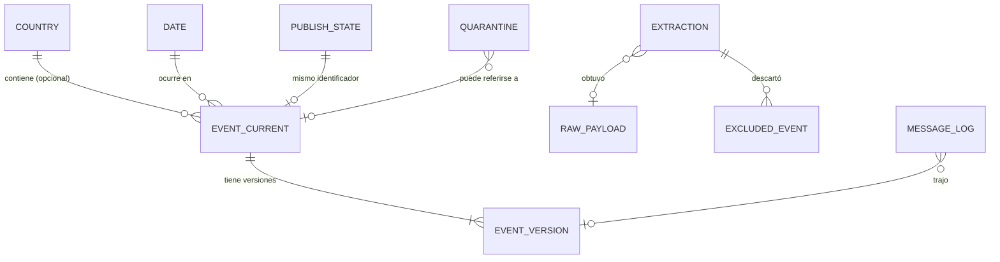

# Data Model: Plataforma y modelo de datos

**Fecha**: 2026-11-14 · **Spec**: `spec.md` · **Decisiones**: [research.md](research.md)

Los nombres de esquemas, tablas y columnas están en inglés (constitución v2.1.0). Este documento
es la base del modelo conceptual, lógico y físico y del diccionario de datos que se publicarán
en `docs/report.md`.

## 1. Modelo conceptual

- Un **terremoto** (`EVENT_CURRENT`) es la versión más reciente conocida de un evento de USGS.
- Un terremoto tiene **una o más versiones** (`EVENT_VERSION`), una por cada `updated` distinto.
- Un terremoto ocurre en **un día UTC** y, si su punto cae dentro de un polígono del catálogo,
  en **un país**; si no, no tiene país.
- Una **extracción** es una consulta a USGS; puede haber guardado un **original** y haber
  descartado elementos que no son terremotos.
- El **estado de publicación** recuerda qué versión de cada evento envió el productor a Kafka.
- La **cuarentena** guarda los mensajes que no se pudieron tratar.
- El **registro de mensajes** anota cada mensaje que el consumidor procesó y su resultado. Es
  una auditoría de la ingesta, no una fuente de recuentos de terremotos.

## 2. Modelo lógico

### Grano de cada tabla

| Esquema | Tabla | Una fila representa | Clave |
|---|---|---|---|
| `core` | `dim_country` | Una entidad del catálogo Natural Earth | `country_id` |
| `core` | `dim_date` | Un día UTC | `date_id` |
| `core` | `extraction` | Una consulta a USGS | `extraction_id` |
| `core` | `raw_payload` | Un contenido original distinto | `content_sha256` |
| `core`, `replay` | `event_current` | La versión más reciente de un terremoto | `event_id` |
| `core`, `replay` | `event_version` | Una versión observada de un terremoto | `(event_id, updated_at)` |
| `core`, `replay` | `quarantine` | Un mensaje rechazado | `quarantine_id`; único `(kafka_topic, kafka_partition, kafka_offset)` |
| `core`, `replay` | `excluded_event` | Una versión de un elemento que no es un terremoto | `(event_id, updated_at)` |
| `core`, `replay` | `publish_state` | La última versión publicada de un evento | `event_id` |
| `core`, `replay` | `message_log` | Un mensaje procesado por el consumidor | `(kafka_topic, kafka_partition, kafka_offset)` |

`replay` usa las dimensiones de `core`. El esquema `bench` solo existe mientras se mide.

### Relaciones

- `event_current.country_id` → `core.dim_country.country_id` (opcional).
- `event_current.event_date` → `core.dim_date.date_id` (obligatoria, derivada de `event_time`).
- `event_version.event_id` → `event_current.event_id` del mismo esquema (borrado en cascada).
- `excluded_event.extraction_id` → `core.extraction.extraction_id` (opcional), también desde
  `replay`.
- `message_log` no tiene clave foránea: un mensaje en cuarentena no corresponde a ninguna
  versión válida.
- `extraction.content_sha256` se relaciona con `raw_payload` por valor, sin clave foránea: la
  extracción sobrevive a la purga del original.
- `publish_state` y `quarantine` no tienen clave foránea a `event_current`: un evento puede
  estar publicado y aún no consumido, o rechazado y no existir nunca como evento válido.

## 3. Modelo físico

### `core.dim_country`

| Columna | Tipo | Nulo | Significado y origen | Ausencias |
|---|---|---|---|---|
| `country_id` | `text` PK | no | `ADM0_A3` de Natural Earth; no es necesariamente ISO | — |
| `name_es` | `text` | no | `NAME_ES`, nombre mostrado en el panel | — |
| `admin_name` | `text` | no | `ADMIN`, nombre administrativo en inglés | — |
| `continent` | `text` | no | `CONTINENT` | — |
| `subregion` | `text` | no | `SUBREGION` | — |
| `iso_a3` | `text` | sí | `ISO_A3`, informativo | `-99` se guarda como nulo |

Carga: una vez, al crear la base, desde `frontend/public/datos/paises.geojson`. 177 filas.

### `core.dim_date`

| Columna | Tipo | Nulo | Significado |
|---|---|---|---|
| `date_id` | `date` PK | no | Día UTC |
| `year`, `quarter`, `month`, `day` | `smallint` | no | Componentes de calendario |
| `iso_week`, `iso_dow` | `smallint` | no | Semana ISO y día de la semana ISO (1 = lunes) |
| `day_of_year` | `smallint` | no | Día del año |

Carga: 1900-01-01 a 2035-12-31, sin huecos.

### `event_current` (en `core` y en `replay`)

| Columna | Tipo | Nulo | Significado, unidad y conversión | Ausencias |
|---|---|---|---|---|
| `event_id` | `text` PK | no | `id` de USGS | Sin él, cuarentena |
| `source` | `text` | no | `usgs_feed` o `usgs_catalog` | — |
| `event_time` | `timestamptz` | no | Ocurrencia; `properties.time` en ms Unix convertido a UTC | Sin él, cuarentena |
| `event_date` | `date` generada | no | Día UTC de `event_time`; FK a `dim_date` | — |
| `updated_at` | `timestamptz` | no | Versión en USGS; `properties.updated` en ms Unix | Sin él, cuarentena |
| `magnitude` | `double precision` | sí | `properties.mag`; adimensional, depende de `mag_type` | Se conserva nulo, se muestra ND |
| `mag_type` | `text` | sí | `properties.magType` (ml, mb, mw…) | Nulo |
| `longitude` | `double precision` | no | `coordinates[0]`, grados, WGS84, [−180, 180] | Inválida: cuarentena |
| `latitude` | `double precision` | no | `coordinates[1]`, grados, WGS84, [−90, 90] | Inválida: cuarentena |
| `depth_km` | `double precision` | sí | `coordinates[2]`, km; puede ser negativa | Se conserva nulo, se muestra ND |
| `place` | `text` | sí | `properties.place`, descripción libre | Nulo |
| `country_id` | `text` FK | sí | Resultado del punto en polígono | Nulo = «Sin país asignado» |
| `quality_flags` | `text[]` | no | Anomalías señaladas sin rechazar (p. ej. `negative_depth`) | Vacío |
| `first_ingested_at` | `timestamptz` | no | Primera vez que el consumidor guardó el evento | — |
| `ingested_at` | `timestamptz` | no | Última escritura del consumidor (tiempo de procesamiento) | — |
| `replayed_at` | `timestamptz` | según esquema | Instante de reproducción | Siempre nulo en `core`; obligatorio en `replay` |

Restricciones: rango de longitud y latitud; magnitud, profundidad y coordenadas finitas (ni NaN
ni infinito); `source` dentro de sus valores; `replayed_at` nulo en `core` y no nulo en
`replay`. No hay mínimo para magnitud ni profundidad.

### `event_version` (en `core` y en `replay`)

| Columna | Tipo | Nulo | Significado |
|---|---|---|---|
| `event_id` | `text` | no | Evento al que pertenece; FK a `event_current` |
| `updated_at` | `timestamptz` | no | Identidad de la versión; PK junto con `event_id` |
| `source` | `text` | no | Procedencia de esta versión |
| `event_time` | `timestamptz` | no | Ocurrencia según esta versión |
| `magnitude`, `mag_type`, `depth_km` | como en `event_current` | sí | Valores de esta versión, para ver los cambios sin abrir el original |
| `longitude`, `latitude` | `double precision` | no | Posición según esta versión |
| `payload` | `jsonb` | no | `Feature` original de USGS, sin transformar |
| `received_at` | `timestamptz` | no | Momento en que el consumidor recibió la versión |
| `kafka_topic`, `kafka_partition`, `kafka_offset` | `text`, `integer`, `bigint` | no | Mensaje que trajo la versión por primera vez |

### `quarantine` (en `core` y en `replay`)

| Columna | Tipo | Nulo | Significado |
|---|---|---|---|
| `quarantine_id` | `bigint` identidad PK | no | Identificador interno |
| `kafka_topic`, `kafka_partition`, `kafka_offset` | `text`, `integer`, `bigint` | no | Referencia al mensaje; única en conjunto |
| `event_id` | `text` | sí | Identificador, si se pudo leer |
| `reason_codes` | `text[]` | no | Códigos estables de motivo; al menos uno |
| `reason_detail` | `text` | no | Explicación legible |
| `payload` | `jsonb` | sí | Mensaje original si es JSON |
| `raw_text` | `text` | sí | Mensaje original si no es JSON |
| `is_synthetic` | `boolean` | no | Caso dañado a propósito para pruebas |
| `quarantined_at` | `timestamptz` | no | Momento del rechazo |

Restricción: al menos uno de `payload` o `raw_text` está presente.

### `excluded_event` (en `core` y en `replay`)

| Columna | Tipo | Nulo | Significado |
|---|---|---|---|
| `event_id`, `updated_at` | `text`, `timestamptz` | no | Identidad de la versión excluida; PK |
| `event_type` | `text` | sí | `properties.type` recibido (quarry blast, explosion…) |
| `reason_code` | `text` | no | Motivo, por defecto `not_earthquake` |
| `extraction_id` | `bigint` FK | sí | Extracción en la que se vio por primera vez |
| `payload` | `jsonb` | no | `Feature` original |
| `first_seen_at` | `timestamptz` | no | Primera observación |

### `publish_state` (en `core` y en `replay`)

| Columna | Tipo | Nulo | Significado |
|---|---|---|---|
| `event_id` | `text` PK | no | Evento |
| `updated_at` | `timestamptz` | no | Última versión confirmada por Kafka |
| `published_at` | `timestamptz` | no | Momento de la confirmación |

### `message_log` (en `core` y en `replay`)

| Columna | Tipo | Nulo | Significado |
|---|---|---|---|
| `kafka_topic`, `kafka_partition`, `kafka_offset` | `text`, `integer`, `bigint` | no | Posición del mensaje; PK conjunta |
| `event_id` | `text` | sí | Evento al que se refiere, si se pudo leer |
| `updated_at` | `timestamptz` | sí | Versión a la que se refiere, si se pudo leer |
| `outcome` | `text` | no | `new`, `revised`, `stale`, `duplicate` o `quarantined` |
| `produced_at` | `timestamptz` | sí | `ingested_at` del mensaje: cuándo lo obtuvo el productor |
| `processed_at` | `timestamptz` | no | Cuándo lo procesó el consumidor |

Denominadores que permite: mensajes recibidos (filas), versiones distintas (`event_version`),
terremotos actuales (`event_current`), repeticiones (`outcome = 'duplicate'`) y rechazos
(`outcome = 'quarantined'`). La diferencia `processed_at − produced_at` mide el retraso del
transporte.

### `core.extraction`

| Columna | Tipo | Nulo | Significado |
|---|---|---|---|
| `extraction_id` | `bigint` identidad PK | no | Identificador |
| `source` | `text` | no | `usgs_feed` o `usgs_catalog` |
| `purpose` | `text` | no | `live`, `historical_load`, `gap_recovery` o `replay_selection` |
| `request_url` | `text` | no | URL completa consultada |
| `request_params` | `jsonb` | sí | Parámetros del catálogo (intervalo, magnitud mínima, tipo) |
| `window_start`, `window_end` | `timestamptz` | sí | Intervalo pedido al catálogo |
| `requested_at` | `timestamptz` | no | Inicio de la consulta |
| `duration_ms` | `integer` | sí | Latencia total, reintentos incluidos |
| `attempt_count` | `smallint` | no | Intentos realizados |
| `http_status` | `integer` | sí | Último código HTTP |
| `outcome` | `text` | no | `ok`, `not_modified`, `http_error`, `timeout`, `invalid_json` o `invalid_structure` |
| `error_detail` | `text` | sí | Descripción del fallo |
| `source_generated_at` | `timestamptz` | sí | `metadata.generated` de la respuesta |
| `record_count` | `integer` | sí | Elementos recibidos |
| `earthquake_count`, `excluded_count`, `published_count` | `integer` | sí | Reparto de esos elementos |
| `content_sha256` | `text` | sí | Huella de la colección de eventos |

### `core.raw_payload`

| Columna | Tipo | Nulo | Significado |
|---|---|---|---|
| `content_sha256` | `text` PK | no | Huella del contenido |
| `encoding` | `text` | no | `gzip` o `file` |
| `body` | `bytea` | sí | Cuerpo comprimido (feed) |
| `file_path` | `text` | sí | Ruta bajo `data/` (catálogo histórico) |
| `byte_size` | `integer` | no | Tamaño sin comprimir |
| `first_seen_at`, `last_seen_at` | `timestamptz` | no | Primera y última vez que se obtuvo este contenido |

Restricción: `body` o `file_path` presente. Retención: se purgan los cuerpos con `last_seen_at`
anterior a `RAW_PAYLOAD_RETENTION_DAYS` (7 por defecto); los registros de fichero no se purgan.

## 4. Operación de escritura

`apply_event_version` existe en `core` y en `replay` con la misma firma (ver
[contracts/database.md](contracts/database.md)). Transiciones del estado de un evento:

| Situación al llegar una versión | Estado actual | Historial | Resultado |
|---|---|---|---|
| Identificador desconocido | Se crea | Se añade | `new` |
| `updated_at` posterior al almacenado | Se actualiza por completo | Se añade | `revised` |
| `updated_at` igual a uno ya visto | Sin cambios | Sin cambios | `duplicate` |
| `updated_at` anterior y no visto antes | Sin cambios | Se añade | `stale` |

Recuentos esperados para la secuencia de la FAQ 12: `new`, `duplicate`, `revised`, `duplicate`,
`new` → 2 eventos actuales, 3 versiones y 5 mensajes en `message_log`.

El consumidor escribe en la misma transacción el resultado de `apply_event_version` (o la fila
de cuarentena) y la fila de `message_log`.

## 5. Índices

Solo las claves primarias y las restricciones únicas son definitivas. Los índices secundarios de
[research.md](research.md) §R11 son candidatos: la medición de esta funcionalidad decide cuáles
se quedan, y el resultado se documenta en `docs/report.md` con la consulta que justifica cada
uno. Un índice se conserva si su consulta es al menos 2 veces más rápida en mediana con
1.000.000 de filas.

## 6. Roles

| Rol | Usado por | Privilegios |
|---|---|---|
| propietario (`POSTGRES_USER`) | inicialización, pruebas y mediciones | todos |
| `observatory_writer` | productor y consumidor | lectura y escritura en `core` y `replay`; ejecutar `apply_event_version`, `replay.reset` y `core.purge_raw_payload`; sin DDL |
| `observatory_reader` | API | solo lectura en `core` y `replay` |

## 7. Qué se elimina del modelo anterior

`fact_sismos`, `dim_geografia`, `dim_tiempo`, `cuarentena`, `ingestion_state`, `event_versions`
y los seis ficheros `db/init/00*.sql`; la fila ficticia «Sin país asignado»; la columna
`source_topic` como mecanismo de aislamiento; el índice duplicado sobre `external_id`; la
restricción `magnitude NOT NULL`; y la creación de tablas desde el código de los servicios.
